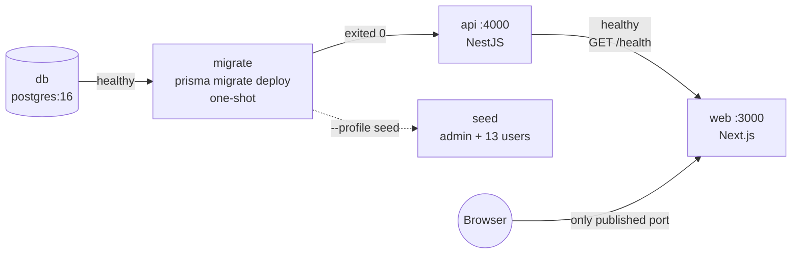
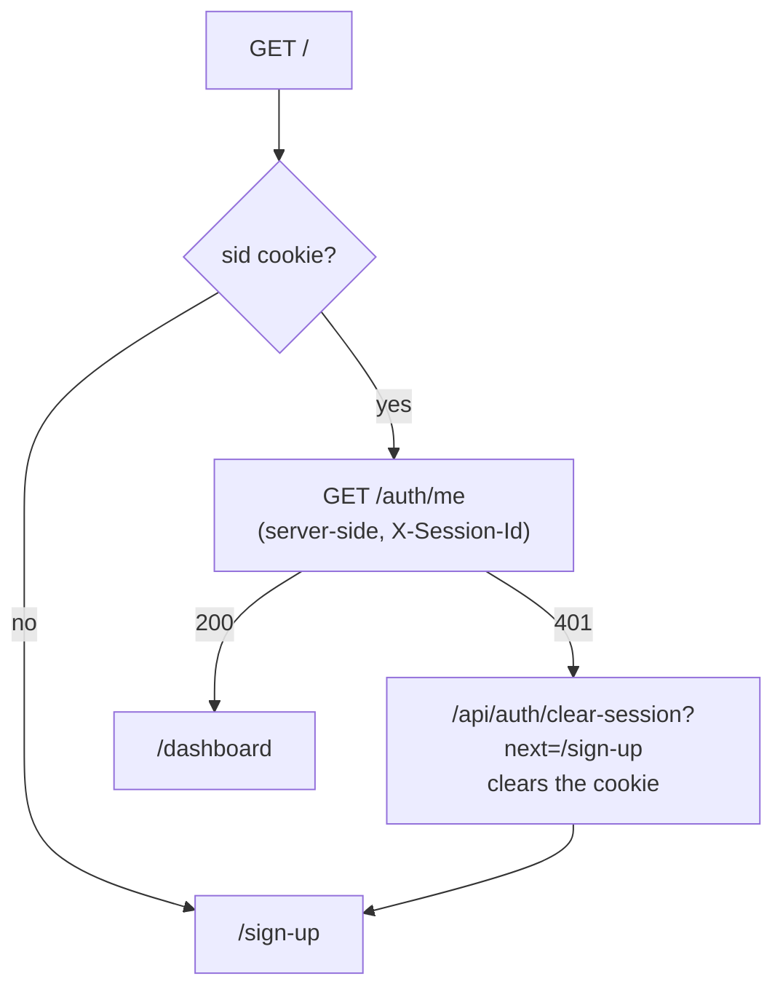
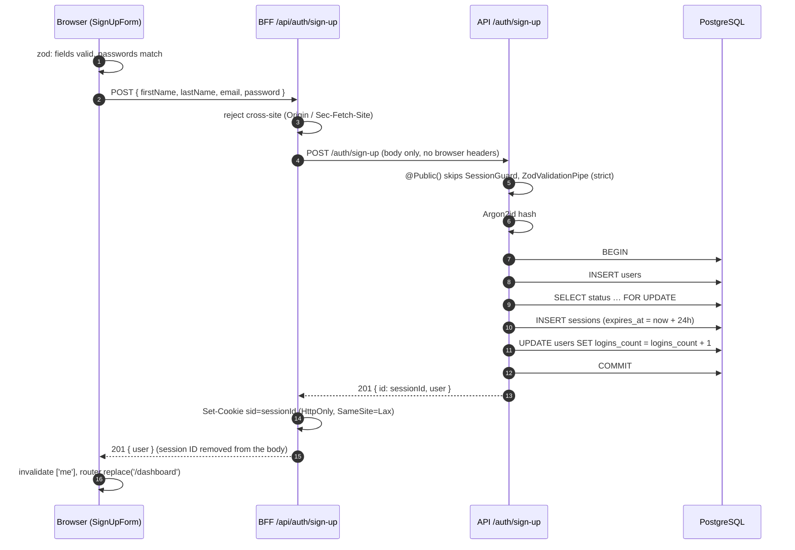
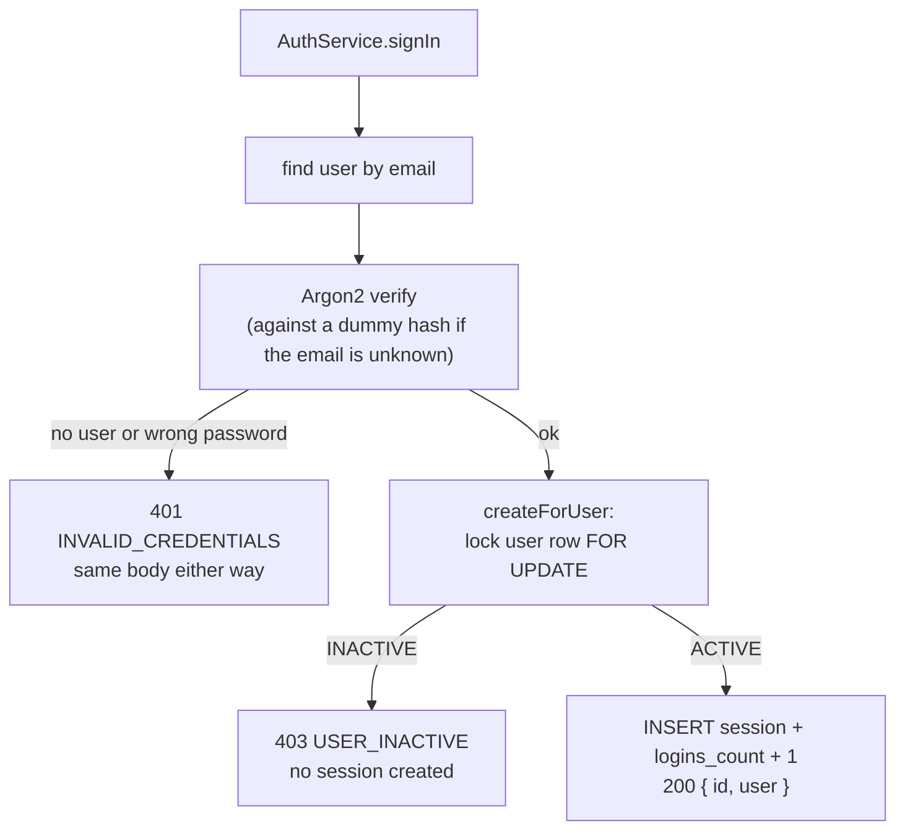
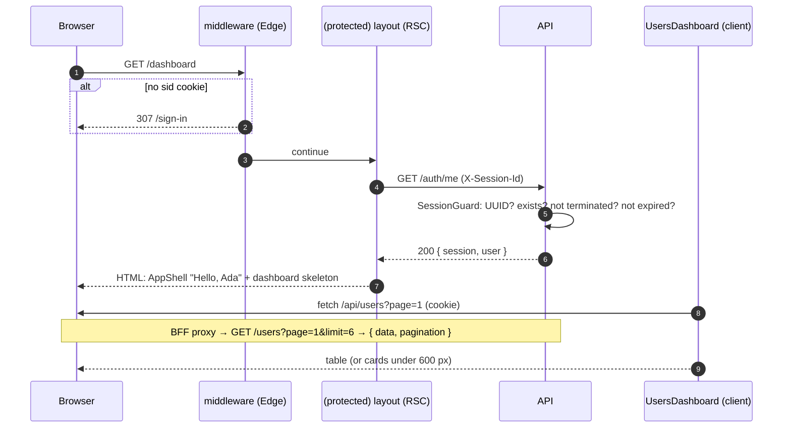
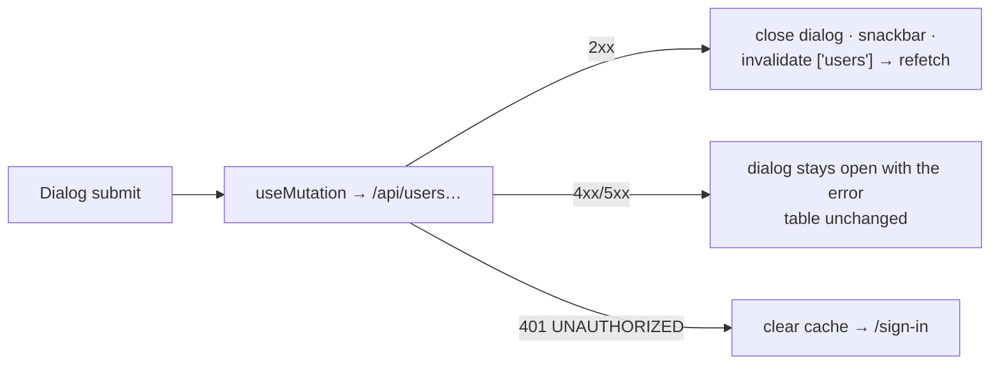
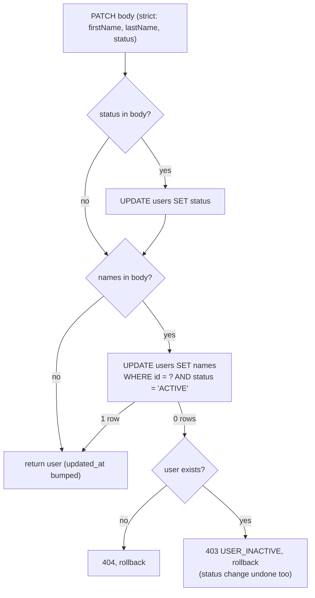
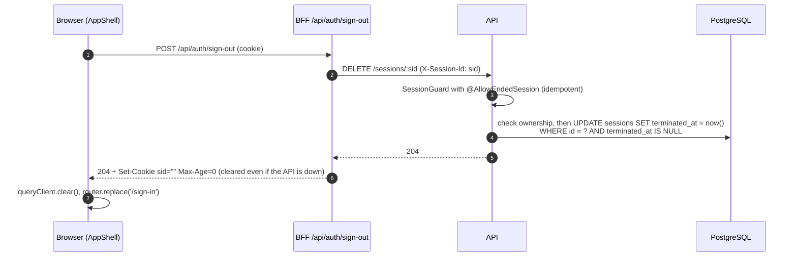
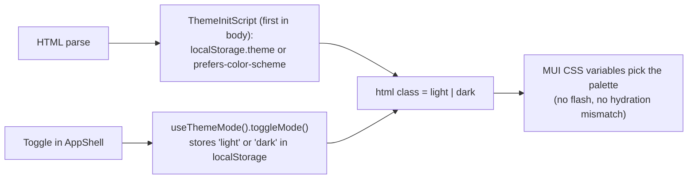

# Application flow, end to end

This doc follows a user through the app, from the first page load to sign-out. At each step it shows which layer acts (browser, Next.js middleware, server components, BFF route handlers, NestJS API, PostgreSQL) and which file does the work. The other docs cover one layer each. This one connects them; follow the links for detail.

| Layer | Where | Role in the flow |
| --- | --- | --- |
| Browser | React client components | Forms, dashboard and theme toggle. It only calls same-origin `/api/*` and never sees the session ID |
| Middleware | [`apps/web/src/middleware.ts`](../apps/web/src/middleware.ts) | Fast redirect based on whether the `sid` cookie is present |
| Server components | `app/page.tsx`, `app/(protected)/layout.tsx` | Confirm the session with the API before rendering |
| BFF | `app/api/**/route.ts`, [`lib/server/http.ts`](../apps/web/src/lib/server/http.ts) | Keeps the session ID in an HttpOnly cookie and sends it to the API as `X-Session-Id` |
| API | `apps/api/src` (NestJS) | `SessionGuard`, Zod validation, domain rules, error mapping |
| Database | PostgreSQL via Prisma | `users` and `sessions` tables; transactions and row locks enforce the rules |

## Contents

0. [Starting the stack](#0-starting-the-stack)
1. [First visit](#1-first-visit)
2. [Sign-up](#2-sign-up)
3. [Sign-in](#3-sign-in)
4. [Opening the dashboard](#4-opening-the-dashboard)
5. [Managing users](#5-managing-users)
6. [Sign-out](#6-sign-out)
7. [When a session ends elsewhere](#7-when-a-session-ends-elsewhere)
8. [Theme selection](#8-theme-selection)
9. [Requirement to flow map](#9-requirement-to-flow-map)
10. [Where each flow is tested](#10-where-each-flow-is-tested)

---

## 0. Starting the stack

`docker compose up --build -d --wait` starts the services in dependency order ([`compose.yaml`](../compose.yaml)):

- Only `web` publishes a port to the host. The browser never talks to the API directly. The BFF reaches it at `API_INTERNAL_URL=http://api:4000` on the internal network.
- On startup the API validates its environment with Zod ([`config/env.ts`](../apps/api/src/config/env.ts)), registers the global `SessionGuard` and `ApiExceptionFilter`, and serves Swagger at `/docs` outside production ([`main.ts`](../apps/api/src/main.ts)).
- `GET /health` pings the database. Compose waits for it before starting `web`.

---

## 1. First visit

The visitor opens `http://localhost:3000/`.

- [`app/page.tsx`](../apps/web/src/app/page.tsx) calls `getCurrentAuth()` ([`lib/server/current-user.ts`](../apps/web/src/lib/server/current-user.ts)). It never trusts the cookie alone: it asks the API (`GET /auth/me`).
- The result is `authenticated`, `expired` (a cookie exists but the API rejects it) or `anonymous`.
- This covers the challenge rule: *"if the user has an active session, forward them to the welcome page; otherwise present the sign-up page."*

A direct visit to `/sign-in` or `/sign-up` with a cookie is sent to `/dashboard` by middleware before any page renders.

---

## 2. Sign-up

### 2.1 In the browser

[`components/auth/sign-up-form.tsx`](../apps/web/src/components/auth/sign-up-form.tsx) uses React Hook Form with `zodResolver(SignUpFormSchema)`.

- `SignUpFormSchema` ([`packages/shared/src/auth.ts`](../packages/shared/src/auth.ts)) extends the API's `SignUpInputSchema` with `confirmPassword` and a `.refine()` that requires the two passwords to match.
- If validation fails (mismatched passwords, bad email, password under 8 characters), **no request is sent**. The first invalid field gets focus and shows its error.
- When validation passes, the form drops `confirmPassword` and posts the parsed values (names trimmed, email lower-cased) to `POST /api/auth/sign-up`. The submit button stays disabled until navigation, so the form can't be submitted twice.

### 2.2 Full request path

Key code:

| Step | File |
| --- | --- |
| BFF handler (shared by sign-up and sign-in) | [`lib/server/auth-routes.ts`](../apps/web/src/lib/server/auth-routes.ts) `startSession()` |
| Controller | [`auth/auth.controller.ts`](../apps/api/src/auth/auth.controller.ts) |
| User and first session in one transaction | [`auth/auth.service.ts`](../apps/api/src/auth/auth.service.ts) `signUp()` |
| Session creation with row lock and login count | [`auth/sessions.service.ts`](../apps/api/src/auth/sessions.service.ts) `createForUser()` |
| Redirect after success | [`components/auth/use-auth-success.ts`](../apps/web/src/components/auth/use-auth-success.ts) |

The challenge says *"consider the id received in the sign-in/sign-up response as an actual session identifier."* The `id` in the API response is the session's UUID. The BFF stores it in the `sid` cookie and adds it as `X-Session-Id` to every later API call. Keeping it out of JavaScript protects it from XSS ([decisions.md](decisions.md#key-decisions)).

### 2.3 Error branches

| API response | What the user sees |
| --- | --- |
| `409 EMAIL_TAKEN` | Error on the email field |
| `400 VALIDATION_ERROR` with `details[].path` | Errors on the matching fields |
| `503` or a network failure | Form-level alert: "service unavailable" |

The whole transaction rolls back on a duplicate email, so no user or session is left half-created.

---

## 3. Sign-in

The sign-up and sign-in pages link to each other. [`sign-in-form.tsx`](../apps/web/src/components/auth/sign-in-form.tsx) posts `{ email, password }` to `POST /api/auth/sign-in`. That handler is the same `startSession()` used for sign-up, pointed at `/auth/sign-in`.

- Unknown emails still go through one Argon2 verification, against a dummy hash, so response time doesn't reveal which emails are registered.
- The inactive check runs **after** the password is verified, so a wrong password never reveals the account's status.
- The row lock means a sign-in racing an admin's deactivation either commits first or sees `INACTIVE`. Concurrent sign-ins never lose a `loginsCount` increment. See [auth-and-sessions.md](auth-and-sessions.md#creating-a-session).
- On success, the BFF sets the cookie and the browser goes to `/dashboard`, as in sign-up.
- On failure, `401` shows "Invalid email or password." and `403` shows "This account is inactive…". The password field is cleared and focused; the email is kept. A `401 INVALID_CREDENTIALS` does **not** trigger the global 401 redirect.

`POST /sessions` (the challenge's "create a new session") calls the same `AuthService.signIn`. It requires credentials, so nobody can create a session for another user by passing a bare `userId`.

---

## 4. Opening the dashboard

The challenge's welcome page (`Hello <first_name>`) is now the app bar of the protected dashboard, as Part 2 asks.

1. **Middleware** ([`middleware.ts`](../apps/web/src/middleware.ts)) checks only whether the cookie is present. This is a quick first redirect, not the security check.
2. **The protected layout** ([`app/(protected)/layout.tsx`](../apps/web/src/app/(protected)/layout.tsx)) calls `requireUser()`, which is the real check. The dashboard page calls it as well; React `cache` deduplicates the two calls, so the API sees one `/auth/me` request.
3. **`AppShell`** ([`components/layout/app-shell.tsx`](../apps/web/src/components/layout/app-shell.tsx)) shows `Hello, <firstName>`, the theme toggle and **Sign out**.
4. **`UsersDashboard`** ([`components/users/users-dashboard.tsx`](../apps/web/src/components/users/users-dashboard.tsx)) loads the users with TanStack Query.

How a user request crosses the BFF:

| Layer | What happens | File |
| --- | --- | --- |
| Client | `apiClient.users.list(page)` → `fetch('/api/users?page=N')` | [`lib/client/api-client.ts`](../apps/web/src/lib/client/api-client.ts) |
| BFF | Forwards only `users` and `users/<id>` paths; rejects cross-site mutations; reads `sid` (no cookie → 401 without calling the API); forwards the body only; on an API 401, clears the cookie | [`app/api/[...path]/route.ts`](../apps/web/src/app/api/[...path]/route.ts) |
| API guard | Global `SessionGuard` resolves the session and sets `request.auth` | [`auth/session.guard.ts`](../apps/api/src/auth/session.guard.ts) |
| API pipe | `ZodValidationPipe(PaginationQuerySchema)`: `page ≥ 1`, `limit` 1–6 | [`common/zod-validation.pipe.ts`](../apps/api/src/common/zod-validation.pipe.ts) |
| Service | `COUNT` and `SELECT … ORDER BY created_at DESC, id DESC LIMIT 6 OFFSET …` in one transaction | [`users/users.service.ts`](../apps/api/src/users/users.service.ts) `list()` |
| Errors | Any exception becomes `{ code, message, details? }` | [`common/api-exception.filter.ts`](../apps/api/src/common/api-exception.filter.ts) |

---

## 5. Managing users

Any signed-in user acts as admin, as the challenge specifies. Mutations are **not optimistic**: the table changes only after the API confirms.

### 5.1 List and pagination (six per page)

- The page number lives in the URL (`/dashboard?page=2`). [`usePageParam()`](../apps/web/src/lib/client/use-page-param.ts) updates it with `history.pushState`, so no server round trip is needed and Back/Forward move between pages.
- `useQuery(['users', page])` uses `keepPreviousData`: the old rows stay on screen with a thin progress bar while the next page loads.
- A page past the end (an old link, or rows deleted elsewhere) is replaced with the last page.

### 5.2 Create

`CreateUserDialog` → `POST /api/users` → `POST /users`.

- The body is validated by `CreateUserInputSchema`. The password is hashed with Argon2id. The status defaults to `ACTIVE` and `loginsCount` starts at 0.
- A duplicate email returns `409 EMAIL_TAKEN`, shown on the email field.
- On success the dashboard goes to page 1, where the new user is listed first.

### 5.3 Update, with the domain rules

`EditUserDialog` → `PATCH /api/users/:id` → `PATCH /users/:id`.

On the client, [`buildUpdate()`](../apps/web/src/components/users/edit-user-dialog.tsx) sends only the fields that changed. It never sends names for a user who ends up inactive. The name fields are disabled while the status is set to Inactive.

On the API, `UsersService.update()` runs in one transaction:

How the challenge's domain rules are enforced:

| Rule | Mechanism |
| --- | --- |
| Creation time can't be updated | `createdAt` isn't in any input schema, and `.strict()` turns it into a 400 |
| Last update time always updated | Prisma `@updatedAt` on every write |
| Inactive users can't have their names changed | The conditional `UPDATE … WHERE status = 'ACTIVE'`. Status is applied first, so reactivating and renaming in one request works, while deactivating and renaming is rejected |
| Inactive users can't create sessions | `SELECT … FOR UPDATE` in `createForUser` (section 3) |

### 5.4 Delete

`DeleteUserDialog` (Cancel has focus by default) → `DELETE /api/users/:id` → `DELETE /users/:id`.

- `deleteMany` removes the user, and `ON DELETE CASCADE` removes their sessions in the same statement.
- Deleting the last row on a page moves the view back one page. A `404` counts as success, since the user is already gone.

### 5.5 Acting on your own account

| Action | Flow |
| --- | --- |
| Rename yourself | Normal PATCH, then `router.refresh()` re-renders the server-side app bar so the greeting shows the new name |
| Deactivate yourself | Warned first. Your current session stays valid; you can't sign in again until someone reactivates you |
| Delete yourself | Your sessions are deleted with the account. The client then calls sign-out to clear the cookie, clears the cache and goes to `/sign-in` |

---

## 6. Sign-out

- [`app/api/auth/sign-out/route.ts`](../apps/web/src/app/api/auth/sign-out/route.ts) always clears the cookie, so the browser is signed out even if the API can't be reached.
- [`sessions.controller.ts`](../apps/api/src/auth/sessions.controller.ts) handles "terminate an existing session". Signing out again with the same session still returns 204. Another user's session ID returns 404, so session IDs can't be probed.
- After termination, every other route rejects that session ID with `401`.

---

## 7. When a session ends elsewhere

A session can end without the browser knowing: it expires after 24 h, is terminated from another tab, or its user is deleted. Two paths handle that.

**A. On a page load (server side).** The `sid` cookie is still there, but `/auth/me` returns 401. Without extra handling, middleware (cookie present → `/dashboard`) and the layout (session invalid → `/sign-in`) would redirect each other forever. Server components can't change cookies, so the layout redirects to [`/api/auth/clear-session`](../apps/web/src/app/api/auth/clear-session/route.ts), which clears the cookie and responds `303 /sign-in`. The diagram is in [web-app.md](web-app.md#stale-cookies).

**B. During client-side requests.** A `/api/users…` call returns 401. The BFF clears the cookie in the same response. `apiClient` then calls the handler installed by [`UnauthorizedRedirect`](../apps/web/src/lib/client/unauthorized-redirect.tsx), which clears the query cache and replaces the route with `/sign-in`.

Deactivation does **not** end existing sessions. It only blocks new ones (see [decisions.md](decisions.md#open-decisions)).

---

## 8. Theme selection

- Before the user chooses, the app follows the OS setting, live. Once they toggle, the explicit choice is saved in `localStorage` and survives closing and reopening the browser. That covers Part 3.
- The server sends the same HTML for both modes. The inline script sets the class before anything paints, and the toggle icon is chosen by CSS, so nothing flips during hydration. Files: [`theme/theme.ts`](../apps/web/src/theme/theme.ts) (`THEME_CONFIG`), [`theme-init-script.tsx`](../apps/web/src/theme/theme-init-script.tsx), [`theme-mode.tsx`](../apps/web/src/theme/theme-mode.tsx).

---

## 9. Requirement to flow map

| Challenge requirement | Flow | Section |
| --- | --- | --- |
| REST API: create, list, update, remove users | `/users` CRUD through the BFF proxy | 4, 5 |
| Create and terminate sessions | Sign-up/sign-in, `POST /sessions`, `DELETE /sessions/:id` | 2, 3, 6 |
| `createdAt` immutable, `updatedAt` always bumped | Strict schemas, `@updatedAt` | 5.3 |
| No name change for inactive users | Conditional `UPDATE` in a transaction | 5.3 |
| Inactive users can't create sessions | `FOR UPDATE` lock and status check | 3 |
| Active session → welcome page with `Hello <first_name>` | `/` → `/dashboard`, `AppShell` greeting | 1, 4 |
| No session → sign-up page; links between sign-up and sign-in | `/` → `/sign-up`, cross-links | 1, 3 |
| Two password inputs checked before calling the backend | `SignUpFormSchema.refine`, no request on mismatch | 2.1 |
| A session is created after sign-up/sign-in, then the welcome page opens | `startSession()` → cookie → `router.replace('/dashboard')` | 2, 3 |
| Log Out ends the session and returns to sign-in | `/api/auth/sign-out` → `DELETE /sessions/:id` | 6 |
| The session ID goes with every request | `sid` cookie → `X-Session-Id` added by the BFF | 2.2, 4 |
| Dashboard: list with 6 per page, create, update, delete | `UsersDashboard` and dialogs | 5 |
| Only signed-in users can open the dashboard | Middleware plus `requireUser()` | 4, 7 |
| Theme choice kept after closing the app | `localStorage` with the pre-paint script | 8 |

---

## 10. Where each flow is tested

| Flow | Tests |
| --- | --- |
| Redirects for anonymous and signed-in visitors | [`e2e/tests/auth.spec.ts`](../e2e/tests/auth.spec.ts), [`middleware.test.ts`](../apps/web/src/middleware.test.ts) |
| Sign-up → dashboard → sign-out → sign-in | `auth.spec.ts` (E2) |
| Password confirmation checked before any request | `auth.spec.ts`, [`sign-up-form.test.tsx`](../apps/web/src/components/auth/sign-up-form.test.tsx) |
| BFF cookie handling, allowlist, cross-site rejection | [`auth-routes.test.ts`](../apps/web/src/app/api/auth/auth-routes.test.ts), [`[...path]/route.test.ts`](../apps/web/src/app/api/[...path]/route.test.ts) |
| Session guard, termination, inactive and deleted users | [`session.guard.test.ts`](../apps/api/src/auth/session.guard.test.ts), [`test/integration/auth.test.ts`](../apps/api/test/integration/auth.test.ts), [`e2e/tests/sessions.spec.ts`](../e2e/tests/sessions.spec.ts) |
| `loginsCount` under concurrent sign-ins; deactivation racing a sign-in | `test/integration/auth.test.ts` (I9, I10) |
| CRUD, domain rules, pagination | [`test/integration/users.test.ts`](../apps/api/test/integration/users.test.ts), [`e2e/tests/users.spec.ts`](../e2e/tests/users.spec.ts), dashboard and dialog component tests |
| Theme follows the OS, then persists after a restart | [`e2e/tests/theme.spec.ts`](../e2e/tests/theme.spec.ts), [`theme-mode.test.tsx`](../apps/web/src/theme/theme-mode.test.tsx) |

How to run them: [testing.md](testing.md).
