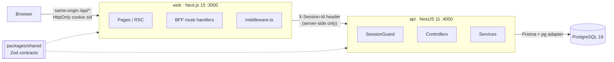

# Architecture

How the system is split, how a request travels through it, and where the code for each part lives.

## Components



| Part | Responsibility | Docs |
| --- | --- | --- |
| `apps/web` | UI (App Router, MUI, TanStack Query) and a backend-for-frontend (BFF) that owns the session cookie | [web-app.md](web-app.md) |
| `apps/api` | REST API: users CRUD, sign-up / sign-in, session lifecycle, validation, error mapping | [api.md](api.md), [auth-and-sessions.md](auth-and-sessions.md) |
| PostgreSQL | Users and sessions, managed by Prisma migrations | [data-model.md](data-model.md) |
| `packages/shared` | Zod schemas and inferred types for every request/response; single source of truth for validation and OpenAPI | below |

**Why a separate API instead of Next.js route handlers only?** It makes the REST contract explicit, testable in isolation (Supertest against a real database), and usable by any client. The Next.js app stays a thin UI plus a security boundary for the browser.

**Why a BFF?** The API authenticates with an `X-Session-Id` header. Storing that ID in browser JavaScript (localStorage, readable cookies) exposes it to XSS. The BFF keeps it in an `HttpOnly` cookie and adds the header server-side, so the browser never sees the session ID or the API host. See [web-app.md](web-app.md#bff-routes).

## Request lifecycle

An authenticated dashboard request, end to end:

```mermaid
sequenceDiagram
  participant B as Browser
  participant W as Next.js BFF
  participant A as NestJS API
  participant D as PostgreSQL
  B->>W: GET /api/users?page=2 (cookie sid)
  W->>W: allowlist path, reject cross-site mutation, read sid
  W->>A: GET /users?page=2 (X-Session-Id)
  A->>A: SessionGuard: UUID? exists? not terminated/expired? user exists?
  A->>D: SELECT session + user
  A->>A: ZodValidationPipe (page, limit ≤ 6)
  A->>D: COUNT + SELECT … ORDER BY created_at DESC, id DESC
  A-->>W: 200 { data, pagination }
  W-->>B: 200 (body relayed; on 401 the cookie is cleared)
```

Server-rendered pages follow the same path without the browser hop: the `(protected)` layout calls `GET /auth/me` with the cookie's session ID before rendering anything.

## Shared contracts (`packages/shared`)

Every payload is defined once as a Zod schema and used in three places:

- **API validation** — `ZodValidationPipe` parses bodies and queries with the shared schemas. Schemas are `.strict()`, so unknown fields (e.g. `loginsCount` in an update) are rejected with 400 instead of silently dropped.
- **OpenAPI** — request/response schemas in Swagger are generated from the same Zod schemas (`z.toJSONSchema`), so the docs cannot drift from validation.
- **Web** — typed API client responses, and (Phase 6) form validation with the same rules plus client-only checks such as password confirmation (`SignUpFormSchema`).

| Module | Contents |
| --- | --- |
| `user.ts` | `User`, `UserStatus`, `CreateUserInput`, `UpdateUserInput`, field rules (names trimmed, 1–100 chars; email lower-cased, ≤ 255; password 8–128) |
| `auth.ts` | `SignUpInput`, `SignInInput`, `SignUpForm` (adds `confirmPassword`) |
| `session.ts` | `Session`, `AuthResponse` (`{ id, user }`), `MeResponse`, `SESSION_HEADER` |
| `pagination.ts` | `PaginationQuery`, `PaginatedResponse<T>`, `USERS_PAGE_SIZE = 6` |
| `errors.ts` | `ApiError` (`{ code, message, details? }`) and the closed list of error codes |

The package builds to CommonJS in `dist/` (`pnpm build:shared`); both apps depend on it via `workspace:*`.

## Repository layout

```text
apps/
  api/
    prisma/                 schema.prisma, migrations/, seed.ts
    src/
      auth/                 sign-up/in, sessions, SessionGuard, decorators, PasswordService
      users/                users CRUD controller/service, public-user mapper
      common/               ApiException, global exception filter, ZodValidationPipe
      docs/                 OpenAPI (Swagger) helpers
      health/               GET /health (DB ping)
      prisma/               PrismaService (pg driver adapter)
      config/               Zod-validated environment
    test/                   unit/ and integration/ (real PostgreSQL)
  web/
    src/
      app/                  routes: /, (auth)/sign-in|sign-up, (protected)/dashboard, api/* (BFF)
      components/           UI components (app shell, …)
      lib/server/           server-only: env, upstream fetch, cookies, current user
      lib/client/           browser: typed API client, query client, 401 redirect
      theme/                MUI themes and light/dark mode provider
      middleware.ts         optimistic route protection
packages/
  shared/                   Zod contracts and types (@um/shared)
docs/                       this documentation and the implementation plans
compose.yaml                Docker Compose (database today; full stack in Phase 10)
```

## Tech stack

| Area | Choice |
| --- | --- |
| Runtime | Node 22, TypeScript 5.9 (strict, `noUncheckedIndexedAccess`) |
| Workspace | pnpm 10 workspaces |
| Web | Next.js 15.5 (App Router), React 19.1, MUI 6, TanStack Query 5 |
| API | NestJS 11 (Express), Zod 4, `@nestjs/swagger` |
| Data | PostgreSQL 16, Prisma 7 (`prisma-client` generator, `@prisma/adapter-pg`) |
| Passwords | Argon2id (`argon2`) |
| Tests | Vitest 3, Supertest, React Testing Library, Playwright (Phase 9) |
| Tooling | ESLint (flat config, typescript-eslint, Next and React Hooks plugins), Prettier, Husky + lint-staged |

Version pins and the reasons for them are recorded in [decisions.md](decisions.md).
