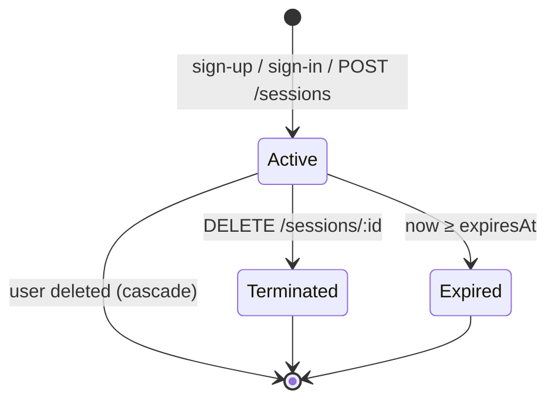

# Authentication and sessions

How users prove who they are, how sessions are created, checked and ended, and which races and leaks the design prevents. Endpoint details are in [api.md](api.md). The browser side (cookie, BFF) is in [web-app.md](web-app.md).

## Model in one paragraph

A session is a database row with a random UUID. Sign-up and sign-in create one and return its ID. Every protected API request carries the ID in `X-Session-Id`, and the API looks it up each time: the session must exist, not be terminated, not be expired, and belong to an existing user. Sign-out sets `terminatedAt`. There are no tokens to decode and nothing to revoke elsewhere: deleting or terminating the row is immediate.



## Passwords

- Hashed with **Argon2id** (`PasswordService`, library defaults; salt and parameters are embedded in each hash).
- Length 8–128, enforced by the shared `PasswordSchema` and again in `PasswordService.hash`.
- `verify` never throws: a mismatch or a malformed hash returns `false`.
- Hashes are never selected for responses (see [data-model.md](data-model.md#invariants-and-how-they-are-enforced)).

## Sign-in

`AuthService.signIn` (used by `POST /auth/sign-in` and `POST /sessions`):

1. Look up the user by (lower-cased) email.
2. Verify the password with Argon2. **For an unknown email, verify against a dummy hash** anyway, so both paths cost one Argon2 verification and response times don't reveal which emails exist.
3. Wrong password or unknown email → the same `401 INVALID_CREDENTIALS` body.
4. Only then create the session. An inactive account is reported (`403 USER_INACTIVE`) only after the password is verified, so a wrong password never reveals account status.

## Sign-up

`AuthService.signUp` hashes the password, then in **one transaction** inserts the user and creates its session through the same path as sign-in. Sign-up therefore counts as the first login (`loginsCount = 1`). A duplicate email (`P2002`) rolls everything back and becomes `409 EMAIL_TAKEN`.

## Creating a session

`SessionsService.createForUser(userId, tx?)` does three things in one transaction:

```sql
SELECT status FROM users WHERE id = $1 FOR UPDATE;   -- lock the user row
-- reject if not ACTIVE (403 USER_INACTIVE)
INSERT INTO sessions (user_id, expires_at) VALUES ($1, now() + TTL);
UPDATE users SET logins_count = logins_count + 1 WHERE id = $1;
```

The row lock is what makes the rules hold under concurrency:

| Race | Without the lock | With the lock |
| --- | --- | --- |
| 10 parallel sign-ins | Lost updates possible on `logins_count` | Serialized: count += 10, 10 sessions (test I9) |
| Admin deactivates a user while they sign in | Sign-in can read `ACTIVE`, then insert a session after the deactivation commits | Sign-in waits for the deactivation's transaction, then sees `INACTIVE` → 403, no session (test I10) |

Test I10 holds an uncommitted deactivation open while a sign-in starts. Removing `FOR UPDATE` makes it fail, so it really guards the race.

## Checking a session (`SessionGuard`)

A global guard (`APP_GUARD`) runs before every route:

1. Routes marked `@Public()` skip it (`/health`, sign-up, sign-in, `POST /sessions`).
2. `X-Session-Id` must be a UUID. If not, it fails without touching the database.
3. `SessionsService.resolve(id)` loads the session with its user and requires `terminatedAt IS NULL` and `expiresAt > now()`.
4. On success, `request.auth = { session, user }`, available through the `@CurrentAuth()` parameter decorator.

Every failure (missing, malformed, unknown, terminated, expired, user deleted) returns the **same** `401 UNAUTHORIZED`, so callers learn nothing about why.

`@AllowEndedSession()` relaxes step 3 for one route, `DELETE /sessions/:id`. The session must still exist and belong to an existing user, but it may already be terminated or expired, so repeated sign-outs are idempotent.

## Ending a session

`DELETE /sessions/:id` → `SessionsService.terminate(id, callerUserId)`:

- The target must belong to the caller's user. Otherwise `404` (not `403`), so session IDs cannot be probed.
- `UPDATE … SET terminated_at = now() WHERE id = ? AND terminated_at IS NULL`: the first call sets it, repeats change nothing and still return 204.
- The terminated session is rejected by every other route immediately.

Other ways a session stops working:

- **Expiry:** after `SESSION_TTL_HOURS` (default 24). No sliding renewal.
- **User deleted:** sessions are removed by `ON DELETE CASCADE`.
- **User deactivated:** existing sessions stay valid until sign-out or expiry, and new sessions are refused. This is a documented default; see [decisions.md](decisions.md#open-decisions).

## Session ID transport in the browser

The API contract is a header. The web app never exposes the ID to JavaScript: the BFF stores it in an `HttpOnly; SameSite=Lax` cookie named `sid` and adds `X-Session-Id` on the server side. Full details, including CSRF defenses and stale-cookie handling, are in [web-app.md](web-app.md#session-cookie).

## Security notes and limits

- Session IDs are random v4 UUIDs (122 bits), stored as-is. A production hardening step would store only a hash of the ID and rotate it on privilege changes.
- No rate limiting, lockout or email verification yet (see [decisions.md](decisions.md#known-limitations)).
- All authenticated users can manage all users. This is a requirement of the exercise, not a production authorization model.
