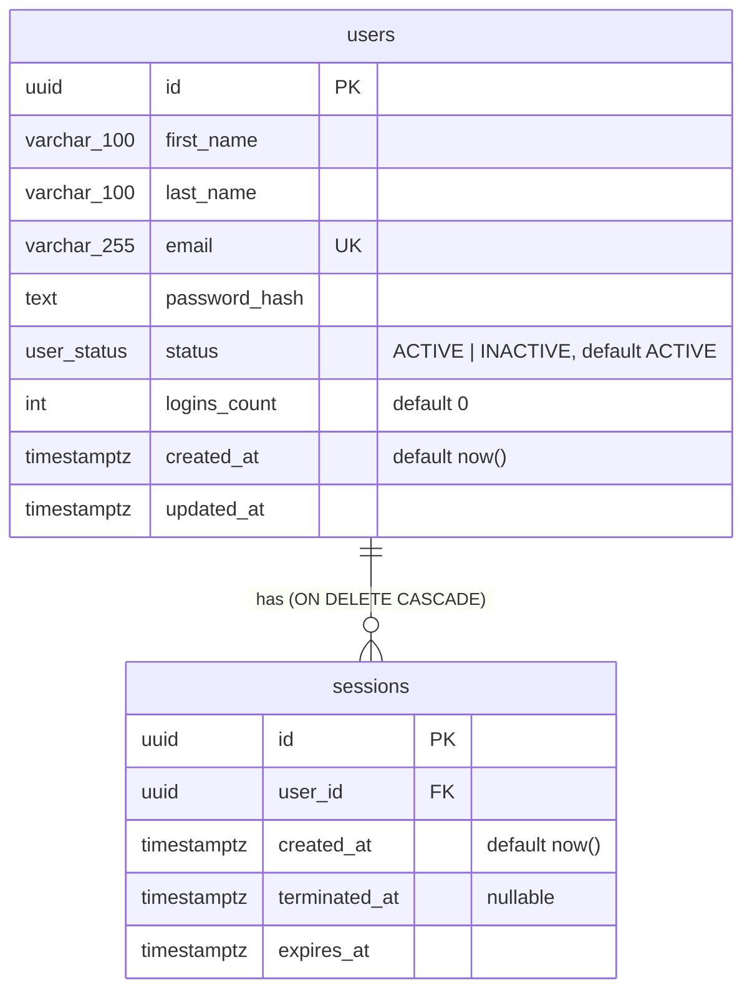

# Data model

PostgreSQL 16, managed with Prisma 7. Source of truth: [`apps/api/prisma/schema.prisma`](../apps/api/prisma/schema.prisma) and the SQL in [`apps/api/prisma/migrations/`](../apps/api/prisma/migrations/).

Columns are `snake_case` in the database and `camelCase` in code (`@map`). Timestamps are `timestamptz(3)` (millisecond precision) and are serialized as ISO 8601 UTC strings.

## `users`

| Column | Type | Rules |
| --- | --- | --- |
| `id` | `uuid` PK | Generated by Prisma |
| `first_name`, `last_name` | `varchar(100)` | Trimmed; empty after trimming is rejected (shared `NameSchema`) |
| `email` | `varchar(255)` unique | Trimmed and lower-cased before storage, so uniqueness is effectively case-insensitive |
| `password_hash` | `text` | Argon2id hash; never selected for responses |
| `status` | enum `user_status` | `ACTIVE` (default) or `INACTIVE` |
| `logins_count` | `int` default 0 | Incremented by exactly 1 per session created (sign-up included) |
| `created_at` | `timestamptz` default `now()` | Immutable: no API path can write it |
| `updated_at` | `timestamptz` | Set by Prisma `@updatedAt` on every successful update |

## `sessions`

| Column | Type | Rules |
| --- | --- | --- |
| `id` | `uuid` PK | The opaque session identifier sent as `X-Session-Id` |
| `user_id` | `uuid` FK → `users.id` | `ON DELETE CASCADE`: deleting a user deletes its sessions |
| `created_at` | `timestamptz` | Set on insert |
| `terminated_at` | `timestamptz` nullable | `NULL` while active; set once on sign-out |
| `expires_at` | `timestamptz` | `created_at` + `SESSION_TTL_HOURS` (default 24 h, no sliding renewal) |

A session authenticates only while `terminated_at IS NULL AND expires_at > now()`. Ended sessions are kept as history; nothing purges them yet (see [decisions.md](decisions.md#known-limitations)).

## Indexes

| Index | Purpose |
| --- | --- |
| `users_email_key` (unique) on `email` | Sign-in lookup; duplicate email → `409 EMAIL_TAKEN` |
| `users_created_at_id_idx` on `(created_at, id)` | Stable pagination: `ORDER BY created_at DESC, id DESC` (the `id` breaks ties) |
| `sessions_user_id_terminated_at_idx` on `(user_id, terminated_at)` | Per-user session queries; FK lookups on cascade delete |

## Invariants and how they are enforced

| Rule | Enforcement |
| --- | --- |
| Inactive users cannot change their names | Name updates use `UPDATE … WHERE id = ? AND status = 'ACTIVE'` inside the same transaction as any status change; 0 rows → `403 USER_INACTIVE` |
| Inactive users cannot start sessions | Session creation locks the user row (`SELECT … FOR UPDATE`) and checks status in the same transaction; see [auth-and-sessions.md](auth-and-sessions.md#creating-a-session) |
| `loginsCount` equals sessions created | Session insert and `logins_count + 1` happen in one transaction on the locked row |
| `createdAt` is immutable | Not in any input schema; update payloads are `.strict()`, so sending it is a 400 |
| No password hash leaves the API | Responses select only `publicUserSelect` columns and build the body field by field (`toPublicUser`) |
| Deleted users cannot authenticate | Sessions cascade-delete with the user, so the session lookup fails → 401 |

## Migrations

- Create (dev, against a disposable DB): `pnpm --filter @um/api db:migrate:dev --name <change>`
- Apply (any environment): `pnpm --filter @um/api db:migrate` (`prisma migrate deploy`)
- Integration tests apply migrations automatically to a separate `<db>_test` database.

The Prisma client is generated into `apps/api/src/generated/prisma` (gitignored) by `pnpm --filter @um/api db:generate`, which also runs on install, build, typecheck and test.

## Seed data (development only)

`pnpm --filter @um/api db:seed` creates one admin and 13 sample users (3 dashboard pages of 6):

- Admin credentials come from `SEED_ADMIN_EMAIL` / `SEED_ADMIN_PASSWORD` (defaults in `.env.example`).
- Sample users get a random throwaway password; they exist to fill the dashboard.
- Idempotent: users are matched by email and never duplicated or overwritten.
- `createdAt` is staggered so the dashboard order is deterministic.
- Refuses to run with `NODE_ENV=production`.
