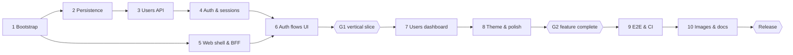

# User Management — Detailed Implementation Plan

Oct 20, 2026 · @Dmytro

## Overview

Build a pnpm monorepo with a Next.js 15 web app, a NestJS API and PostgreSQL, delivered in 10 phases and about 60 tasks, each ending in a verified commit. The plan below breaks the source plan into tasks with acceptance criteria so every phase can be picked up and closed independently.

**Locked decisions** (change here first, everything downstream follows):

| Area | Choice | Why |
| --- | --- | --- |
| Workspace | pnpm workspaces: `apps/web`, `apps/api`, `packages/shared` | Shared Zod contracts and types between web and API |
| Runtime | Node 22 LTS, TypeScript 5.x strict | Meets the >=22 / >=5 requirement |
| Web | Next.js 15 App Router, MUI 6, React Hook Form + Zod, TanStack Query | Required framework; mature form and cache tooling |
| API | NestJS 11 (Express), class-validator or Zod pipes | Explicit REST layer, guards, filters |
| Data | PostgreSQL 16, Prisma ORM + migrations | Typed client, migration history |
| Auth transport | Next.js BFF sets HttpOnly cookie; forwards `X-Session-Id` to API | Keeps the session ID out of JS while meeting the per-request header requirement |
| Passwords | Argon2id | Current OWASP recommendation |
| Tests | Vitest + Supertest (API), Vitest + RTL (web), Playwright 1.50+ (E2E) | One runner for unit and component tests |
| Runtime | Docker Compose: `db`, `migrate` (one-shot), `api`, `web`, `e2e` profile | Avoids migration races; one-command start |

**Conventions**

- Conventional Commits; one commit per verified task group, never a broken build on `main`.
- No hiring-company name anywhere: repo, README, UI, package names, commit messages.
- Shared error shape `{ code, message, details? }`; dates as ISO 8601 UTC strings.
- Every task below is done only when its acceptance criteria pass locally and in CI.

## Milestones and sequencing

Ship the vertical slice (sign-up → dashboard → logout → sign-in) at gate G1 before any CRUD polish; API and web shell work can overlap until then.

Gate criteria:

- **G1 vertical slice** — E2 passes against the Compose stack; API integration suite green.
- **G2 feature complete** — all CRUD, pagination and theme tasks closed; component tests green.
- **Release** — T10.7 cold start from a clean clone passes the full E2E suite; branding sweep clean.

## Phase tasks

Each task lists what to build and the check that closes it. IDs (T1.1…) are referenced by the test matrix and traceability table.

### Phase 1 — Bootstrap monorepo

Commit: `chore: bootstrap TypeScript monorepo`

- [x] **T1.1** Init repo, `.gitignore`, `.nvmrc` (22), `packageManager` pin, `pnpm-workspace.yaml` with `apps/*`, `packages/*`. *Done when:* `pnpm install` succeeds from clean clone.
- [x] **T1.2** Root `tsconfig.base.json` (strict, `noUncheckedIndexedAccess`, ES2022), per-package `tsconfig` extending it. *Done when:* `pnpm -r typecheck` passes on empty packages.
  - *Note:* TypeScript pinned to `~5.9` (typescript-eslint does not support TS 7 yet; meets >=5).
- [x] **T1.3** ESLint (flat config, typescript-eslint) + Prettier; root scripts `lint`, `format`, `typecheck`, `test`. *Done when:* `pnpm lint` passes.
- [x] **T1.4** `packages/shared`: Zod schemas + inferred types for `User`, `UserStatus`, `Session`, `SignUpInput`, `SignInInput`, `CreateUserInput`, `UpdateUserInput`, `PaginatedResponse<T>`, `ApiError`. *Done when:* both apps import it via `workspace:*`.
- [x] **T1.5** `.env.example` with `POSTGRES_PASSWORD`, `DATABASE_URL`, `API_INTERNAL_URL`, `SESSION_TTL_HOURS`, `COOKIE_SECURE`. *Done when:* every variable read in code is listed.
- [x] **T1.6** Husky + lint-staged pre-commit (lint, format). *Done when:* a bad commit is blocked.

### Phase 2 — Persistence

Commit: `feat(api): add user and session persistence`

- [x] **T2.1** Scaffold NestJS app in `apps/api`; `ConfigModule` with Zod-validated env; `GET /health` (DB ping). *Done when:* app boots and `/health` returns 200.
  - *Note:* NestJS pinned to `^11` (v12 is ESM-only). `/health` returns 503 `SERVICE_UNAVAILABLE` when the DB is down. Tests via Vitest + `unplugin-swc` (decorator metadata); `test` = unit, `test:int` = real Postgres.
- [x] **T2.2** Prisma schema: `User` (uuid id, firstName/lastName varchar(100), email unique varchar(255), passwordHash, status enum ACTIVE/INACTIVE default ACTIVE, loginsCount int default 0, createdAt default now, updatedAt `@updatedAt`), `Session` (uuid id, userId FK, createdAt, terminatedAt nullable, expiresAt). *Done when:* `prisma validate` passes.
- [x] **T2.3** Indexes: `users(email)` unique, `users(created_at, id)`, `sessions(user_id, terminated_at)`; FK `onDelete: Cascade` for sessions. *Done when:* migration SQL shows all three.
- [x] **T2.4** Initial migration + `PrismaService` with graceful shutdown. *Done when:* `prisma migrate deploy` applies on an empty DB.
  - *Note:* Prisma pinned to `7.10.1` (v8 is RC): `prisma-client` generator (CJS) to gitignored `src/generated/prisma`, `prisma.config.ts`, `@prisma/adapter-pg`. Migration SQL verified on Postgres 16; confirm with `pnpm --filter api exec prisma migrate dev` locally (should report no drift).
- [x] **T2.5** Seed script: 1 known admin (dev only) + 13 random users (exercises 3 pages). *Done when:* `pnpm --filter api db:seed` is idempotent.
  - *Note:* admin credentials from `SEED_ADMIN_EMAIL` / `SEED_ADMIN_PASSWORD`; refuses `NODE_ENV=production`; matches by email, never overwrites.
- [x] **T2.6** `compose.yaml` with `db` only (healthcheck, named volume) for local dev. *Done when:* `docker compose up db` is healthy.
  - *Note:* file written and `docker compose config` validated; port bound to `127.0.0.1:5433` (avoids a host Postgres on 5432) for host-side dev. Confirmed Oct 21: `user-management-db-1` reports `healthy`; `prisma migrate deploy` and the API ran against it.

### Phase 3 — Users API

Commit: `feat(api): implement user management`

*Status:* done — 29 unit + 24 integration tests green. Integration tests use a separate `<db>_test` database (or `TEST_DATABASE_URL`), created and migrated by the Vitest global setup, so they never truncate dev data.

- [x] **T3.1** Global `ValidationPipe`/Zod pipe (whitelist, forbid unknown), global exception filter mapping to `{ code, message, details? }`; Prisma P2002 → 409, P2025 → 404, connection errors → 503. *Done when:* unit tests cover each mapping.
  - *Note:* per-route `ZodValidationPipe` with the shared `.strict()` schemas (unknown keys → 400 with `details[{ path, message }]`); global `ApiExceptionFilter` via `APP_FILTER`. Also maps malformed JSON → 400 and pg driver connection errors (`ECONNREFUSED` etc.) → 503; unknown errors → generic 500.
- [x] **T3.2** `UsersService.list(page, limit)`: order `createdAt DESC, id DESC`, `limit` fixed max 6, `page >= 1`, returns `{ data, pagination: { page, limit, total, totalPages } }`. *Done when:* page beyond last returns empty `data` with correct totals.
  - *Note:* `limit` above 6 → 400 rather than silently clamped.
- [x] **T3.3** `UsersService.create`: trim names, reject empty, hash password, default ACTIVE. *Done when:* response never contains `passwordHash`.
  - *Note:* duplicate email → 409 `EMAIL_TAKEN` (emails are lower-cased by the shared schema).
- [x] **T3.4** `UsersService.update`: DTO allows only `firstName`, `lastName`, `status`; name change uses conditional update `WHERE id = ? AND status = 'ACTIVE'` in the same transaction as any status change; inactive + name change → 403 `USER_INACTIVE`. *Done when:* reactivating and renaming in one request is ordered status-first (documented).
  - *Note:* status applied first in one transaction: reactivate + rename succeeds; deactivate + rename → 403 and nothing is written.
- [x] **T3.5** `UsersService.delete`: transaction deletes sessions then user (or cascade). *Done when:* deleted user's session gets 401.
  - *Note:* relies on the `ON DELETE CASCADE` FK; integration test asserts the session row is gone. The "subsequent 401" check lands with the session guard (T4.5).
- [x] **T3.6** `UsersController`: `GET /users`, `POST /users`, `PATCH /users/:id` (ParseUUIDPipe), `DELETE /users/:id` (204). *Done when:* Supertest suite green.
  - *Note:* endpoints are unauthenticated until the session guard lands in Phase 4.
- [x] **T3.7** User serializer/mapper used by every response path. *Done when:* a test asserts no response body includes `password`.
  - *Note:* `publicUserSelect` never reads `passwordHash`; `toPublicUser` copies fields explicitly.

### Phase 4 — Authentication & sessions

Commit: `feat(auth): implement session authentication`

*Status:* done — 45 unit + 49 integration tests green (I1–I4, I8–I13 covered). All routes except `/health`, sign-up, sign-in and `POST /sessions` now require `X-Session-Id`.

- [x] **T4.1** `PasswordService` (argon2id hash/verify), min length 8. *Done when:* unit tests for hash/verify/mismatch.
  - *Note:* pulled forward into Phase 3 (needed by `POST /users`): `PasswordService` + `PasswordModule`, unit-tested.
- [x] **T4.2** `SessionsService.createForUser(userId)`: one transaction — lock user row (`SELECT … FOR UPDATE`), reject INACTIVE (403), insert session with `expiresAt`, increment `loginsCount`. *Done when:* concurrent-signin test shows count == sessions created.
  - *Note:* accepts an optional `tx` so sign-up joins it. I10 holds an uncommitted deactivation while a sign-in starts; verified the test fails if `FOR UPDATE` is removed.
- [x] **T4.3** `POST /auth/sign-up`: create user + session in one transaction; 409 on duplicate email; returns `{ id: sessionId, user }`. Signup counts as first login (`loginsCount = 1`). *Done when:* integration test passes.
- [x] **T4.4** `POST /auth/sign-in`: verify credentials (constant-time path for unknown email), call `createForUser`; 401 on bad credentials, 403 on inactive. *Done when:* inactive sign-in test passes.
  - *Note:* returns 200. Unknown email verifies against a memoized dummy argon2 hash; wrong password and unknown email return the identical `INVALID_CREDENTIALS` body. Inactive check runs only after the password verifies, so status is never revealed to a wrong password.
- [x] **T4.5** `SessionGuard` (global, `@Public()` opt-out): reads `X-Session-Id`, validates UUID, session exists, not terminated, not expired, user exists; attaches `req.auth`. *Done when:* every non-public route rejects missing/terminated/expired session with 401.
  - *Note:* registered via `APP_GUARD`; `@CurrentAuth()` param decorator; one generic 401 `UNAUTHORIZED` for every failure. Also closes the T3.5 "deleted user's session gets 401" check.
- [x] **T4.6** `GET /auth/me` returns session + safe user. *Done when:* integration test passes.
- [x] **T4.7** `DELETE /sessions/:id`: only the caller's own session; sets `terminatedAt` once; repeat returns 204. *Done when:* another user's session ID returns 404.
  - *Note:* "own" = any session of the caller's user. Route is marked `@AllowEndedSession()`: the header session must exist, but may already be terminated/expired, so a repeated sign-out with the same session returns 204 (I11) while every other route rejects it.
- [x] **T4.8** `POST /sessions`: requires email + password body (credential-verified), never a bare `userId`. *Done when:* request with only `userId` returns 400.
- [x] **T4.9** OpenAPI via `@nestjs/swagger` at `/docs` (dev only). *Done when:* all 9 endpoints documented with examples.
  - *Note:* enabled when `NODE_ENV !== 'production'` (JSON at `/docs-json`). Request/response schemas are generated from the shared Zod contracts (`z.toJSONSchema`, OpenAPI 3.0), so docs cannot drift from validation; `X-Session-Id` declared as an apiKey scheme. `/health` excluded from docs. Integration test asserts exactly the 9 operations.

### Phase 5 — Web shell & BFF

Commit: `feat(web): add app shell and session integration`

*Status:* done — 36 web unit/component tests green; build, lint and typecheck clean. Verified against the real API with curl and headless Chromium (redirects, cookie flags, stale-cookie recovery, sign-out; console clean). T5.4 and T5.6 closed by E1 in Phase 9.

- [x] **T5.1** Scaffold Next.js 15 in `apps/web` (App Router, `output: 'standalone'`). *Done when:* `pnpm --filter web build` succeeds.
  - *Note:* Next `15.5.28`, React `19.1`, MUI `6.5` (per locked decisions). `outputFileTracingRoot` = repo root for the monorepo standalone bundle; `next.config.ts` loads the root `.env` for host-side dev. `typecheck` runs `next typegen` first, and `next-env.d.ts` is gitignored, so a clean clone typechecks. System font stack (no Google Fonts fetch at build time). `next start` warns under `standalone`; the Docker image will run `server.js` (T10.2). Lint adds `@next/eslint-plugin-next` + `eslint-plugin-react-hooks`.
- [x] **T5.2** BFF route handlers under `app/api/[...path]/route.ts`: forward to `API_INTERNAL_URL`, inject `X-Session-Id` from HttpOnly cookie `sid`, pass status + body through. *Done when:* browser never sees the API host or the session ID.
  - *Note:* allowlist: only `users` and `users/:id` are proxied; anything else is 404, because `/auth/*` and `/sessions` responses contain session IDs. Browser cookies are never forwarded upstream. No cookie → 401 without calling the API; upstream 401 → cookie cleared; API unreachable → 503. Cross-site mutations (`Origin` mismatch or `Sec-Fetch-Site: cross-site`) → 403, on top of SameSite=Lax.
- [x] **T5.3** BFF auth handlers: `sign-up`/`sign-in` set cookie `sid` (HttpOnly, SameSite=Lax, Secure via env, Max-Age = TTL) and return user only; `sign-out` calls `DELETE /sessions/:id` and clears cookie. *Done when:* cookie flags verified in a test.
  - *Note:* also `GET /api/auth/me` (returns `{ user }`, session stripped) and `GET /api/auth/clear-session?next=` (see T5.4). Sign-out clears the cookie even if the API is unreachable; it never puts a non-UUID cookie value into the API path. Sign-in/up also reject cross-site requests (login CSRF).
- [x] **T5.4** `middleware.ts`: no `sid` on `/dashboard` → redirect `/sign-in`; `sid` on auth pages → `/dashboard`. Server components confirm via `/auth/me` (cookie presence alone is not trusted). *Done when:* E2E route-protection test passes.
  - *Note:* implemented and unit-tested; E1 (`e2e/tests/auth.spec.ts`) passes in Phase 9, and E6 covers the stale-cookie path. `requireUser()` in the `(protected)` layout. A stale cookie would otherwise loop (middleware → `/dashboard` → `/sign-in` → …), and server components can't modify cookies, so they redirect to `/api/auth/clear-session`, which drops the cookie and continues to an allowlisted auth page.
- [x] **T5.5** MUI setup with `AppRouterCacheProvider`, light/dark themes, TanStack Query provider, typed `apiClient` with central 401 → redirect. *Done when:* a 401 from any query lands on `/sign-in`.
  - *Note:* only `401 UNAUTHORIZED` redirects (it also clears the query cache); `401 INVALID_CREDENTIALS` on sign-in does not. 4xx errors are not retried. Theme mode switches in memory; persistence comes in Phase 8. Also adds `app/error.tsx` (retry) and a favicon.
- [x] **T5.6** Root `/` page: `/auth/me` → `/dashboard` if authenticated, else `/sign-up`. *Done when:* both branches covered by E2E.
  - *Note:* implemented; E1 covers both branches (anonymous → `/sign-up`, signed in → `/dashboard`). A stale cookie goes through `clear-session` to `/sign-up`. Phase 9 fix: `clear-session` now sends a relative `Location` (in Docker, `request.url` is `http://0.0.0.0:3000`, which the E2E run caught).

### Phase 6 — Auth flows (UI)

Commit: `feat(web): add authentication flows`

*Status:* done — 13 new component tests (49 web tests total) green; build, lint, typecheck and format clean. Also driven in headless Chromium against the production build and a stub API: mismatch blocks the request, sign-up → dashboard, Back skips the form, 401/403 messages, 409 on the email field, mobile width. Full-stack coverage comes with E2 (Phase 9).

- [x] **T6.1** `/sign-up` form: first name, last name, email, password, confirm password; Zod `refine` on password match; submit disabled while pending. *Done when:* RTL test proves mismatch makes no network call.
  - *Note:* React Hook Form + `@hookform/resolvers` (`zodResolver`) with the shared `SignUpFormSchema`; parsed output (trimmed, lower-cased email) is sent without `confirmPassword`. 409 `EMAIL_TAKEN` and 400 `details[{ path }]` map onto fields. The button stays disabled from submit until navigation, and Enter-key resubmits are ignored while busy.
- [x] **T6.2** `/sign-in` form: email, password; server errors mapped to field/form messages (401 generic "invalid credentials", 403 "account inactive"). *Done when:* both error states render.
  - *Note:* form-level `Alert` for 401/403/network errors (the 401 copy never says which field was wrong); the password is cleared and focused for the retry. Mapping is shared in `components/auth/form-errors.ts`.
- [x] **T6.3** On success: invalidate `['me']` query, `router.replace('/dashboard')`. *Done when:* back button does not return to the form.
  - *Note:* `useAuthSuccess()`. Component tests assert `replace` (never `push`) and the `['me']` invalidation; the browser check confirmed Back lands on the page before the form. Middleware also bounces an authenticated user off the auth pages.
- [x] **T6.4** Cross-links sign-up ⇄ sign-in; accessible labels, autocomplete attributes, keyboard submit. *Done when:* axe check shows no violations.
  - *Note:* axe-core (dev dependency) runs on both pages inside the auth layout: zero violations (`color-contrast` disabled in jsdom; covered by Playwright later). `autocomplete`: `given-name`, `family-name`, `email`, `new-password` / `username`, `current-password`. Enter submits (tested).

### Phase 7 — Users dashboard

Commit: `feat(web): implement user dashboard`

*Status:* implemented — 33 new web tests (82 total) green; build, lint, typecheck and format clean. Also driven in headless Chromium against the production build and a stateful stub API (14 users): pagination and Back, `?page=` deep links, reactivate + rename, deleting the last row of a page, create → page 1, self-rename refreshes the app bar, sign-out kills the old cookie, self-delete signs out, no horizontal page overflow at 390 px and 1280 px. T7.6 closed by its E2E check in Phase 9.

- [x] **T7.1** Layout: app bar with current user name, theme toggle, logout. *Done when:* logout ends on `/sign-in` and the old cookie is rejected.
  - *Note:* app bar from Phase 5 (`components/layout/app-shell.tsx`). Browser check: after sign-out, re-adding the old `sid` cookie still lands on `/sign-in` and `/api/users` returns 401; the API side is I11. A full E2 run comes in Phase 9.
- [x] **T7.2** Users table: name, email, status chip, logins, created, updated; page from `?page=` search param; MUI `Pagination` with `totalPages`. *Done when:* 13 users → 3 pages of 6/6/1.
  - *Note:* C3 covers 6/6/1. `usePageParam()` reads `?page=` (invalid → 1, page 1 = bare URL) and writes with `history.pushState`, which Next syncs into `useSearchParams` without a server round trip; Back/Forward work. A page past the end replaces itself with the last page. `keepPreviousData` avoids skeleton flashes between pages. Own row tagged "You". Dates use the viewer's locale in `<time dateTime>`.
- [x] **T7.3** Loading skeleton, empty state, error state with retry. *Done when:* each state has a component test.
  - *Note:* 6 skeleton rows with `aria-busy`; empty state with a "New user" action; error `Alert` with Retry (4xx not auto-retried, 5xx retried twice first). A thin progress bar shows background refetches.
- [x] **T7.4** Create dialog (names, email, password, status). *Done when:* new user appears on page 1 after success.
  - *Note:* shared `CreateUserInputSchema`; 409 → email field. On success: navigate to page 1 (newest first), refetch, snackbar.
- [x] **T7.5** Edit dialog: names disabled when status is INACTIVE (re-enabled live when switched to ACTIVE); `createdAt` read-only. *Done when:* RTL test for disabled inputs.
  - *Note:* C5. Email and createdAt are read-only fields. Switching to Inactive resets unsaved name edits. `buildUpdate()` sends only changed fields and never sends names when the result is INACTIVE (the API would reject the whole request); reactivate + rename go in one request (status applied first). Nothing changed → closes without a request. A 403 `USER_INACTIVE` race shows a form error; 404 closes with a snackbar and refetches.
- [x] **T7.6** Delete confirmation dialog; deleting last row on a page moves to previous page. *Done when:* E2E covers the edge.
  - *Note:* C6 and a component test cover confirmation and the last-row move; E3 covers cancel/confirm, and the `users.spec.ts` T7.6 test deletes the only row on the last page and lands on the previous page with 6 rows. A 404 on delete counts as done (already gone).
- [x] **T7.7** Mutations invalidate `['users']`; snackbar success/error feedback; non-optimistic by default. *Done when:* failed mutation leaves table unchanged.
  - *Note:* tested: a 500 on delete keeps the row, shows the error and triggers no refetch. Success → snackbar. Failures are shown inside the open dialog (form `Alert`) so the input isn't lost; only "user no longer exists" uses an error snackbar.
- [x] **T7.8** Deleting or deactivating your own account: confirm, then sign out (deleted) or keep session (deactivated, documented). *Done when:* behavior documented in README.
  - *Note:* self-delete dialog says you will be signed out; afterwards the BFF clears the cookie and you land on `/sign-in`. Self-deactivation shows a warning in the edit dialog and keeps the session. Renaming yourself calls `router.refresh()` so the server-rendered app bar updates. Documented in README ("Your own account") and `docs/decisions.md`.

### Phase 8 — Theme persistence & polish

Commit: `feat(web): persist theme preference`

*Status:* done (T8.3 closed by the mobile Playwright smoke in Phase 9). 99 web, 45 API unit and 49 API integration tests green; build, lint, typecheck and format clean.

- [x] **T8.1** Theme stored in `localStorage` key `theme` **and** mirrored to a `theme` cookie so the server renders the right mode (no flash). *Done when:* reload in dark mode shows no light flash.
  - *Note:* changed approach, same goal: no cookie. MUI CSS-variable color schemes (`cssVariables` + `colorSchemes`) with `InitColorSchemeScript` (wrapped as `ThemeInitScript`, first script in `<body>`) setting `class="light|dark"` on `<html>` before any content is parsed, so the server never needs to know the mode. A cookie can't avoid the flash on a first visit with a dark OS, and reading it in the root layout would make the static auth pages dynamic. Storage keys and class strategy live in one `THEME_CONFIG` shared by the provider and the script; the toggle icon is chosen by CSS so nothing flips at hydration. Verified in headless Chrome against the production build: OS light, OS dark, and stored `dark` reopened in a new context (OS light) all show the right class and background at the first visible node; no console or hydration errors. Recorded in `docs/decisions.md`. E5 (`theme.spec.ts`) passes in Phase 9: stored `dark` in a new context with OS light is dark at the first visible element.
- [x] **T8.2** Default from `prefers-color-scheme` when nothing stored. *Done when:* unit test of resolver.
  - *Note:* `defaultMode: 'system'`; following the OS is not stored, so OS changes are followed live until the user toggles. C7 (`theme/theme-mode.test.tsx`) covers `resolveThemeMode()`, the real init script executed in jsdom, and the provider (start from storage/OS, toggle persists).
- [x] **T8.3** Responsive pass: table collapses to cards under 600 px. *Done when:* mobile Playwright smoke passes.
  - *Note:* implemented. `UsersTable` renders the table and `UserCardList` (a `<ul aria-label="Users">` of cards with the same fields and action labels) and a desktop-first CSS breakpoint shows one, so SSR already matches the viewport. Pagination uses `siblingCount=0` and small buttons below 600 px. 5 component tests (cards, actions, skeleton, axe, default layout). Checked in headless Chrome against the real API + dev DB (14 temp users, removed afterwards): at 390 px (iPhone 13) the cards are visible and the table is hidden, there are 6 cards, pagination fits (right edge 293 px), there is no horizontal overflow on the dashboard, sign-in or sign-up, and the edit dialog fits (32–358 px); at 1280 px the table is shown and the cards are hidden; no console errors. Mobile smoke (`@mobile`, Pixel 7 project) passes in Phase 9: 6 cards, table hidden, pagination visible, no horizontal overflow, dialog opens.
- [x] **T8.4** Copy, focus management in dialogs, `<title>` per page. *Done when:* manual review checklist ticked.
  - *Review checklist* (Oct 21; browser items checked in headless Chrome against the production build + real API):
    - [x] Every page has a distinct `<title>` (`… · User Management`): Sign in, Create account, Users, Page not found (HTTP 404), Something went wrong (`error.tsx` renders `<title>`; checked with the API stopped).
    - [x] Unknown URLs get an app-styled 404 (`app/not-found.tsx`) instead of Next's default.
    - [x] Each dialog focuses its first useful control on open; Delete focuses Cancel (component tests; New user also checked keyboard-only in the browser).
    - [x] Escape/Cancel returns focus to the opening button (component tests + browser).
    - [x] When the opening row disappears (delete, or edit finds the user gone), focus moves to the "Users" heading instead of `<body>` (test fails without the fix).
    - [x] No Zod default messages reach forms: empty email → "Required"; email > 255 and sign-in password > 128 → "At most N characters" (shared schemas; 2 tests updated).
    - [x] Copy is sentence case, with curly apostrophes and consistent verbs (Create / Save / Delete / Sign out) and success toasts (Created / Saved / Deleted …).

### Phase 9 — E2E & CI

Commit: `test: cover core user journeys with Playwright`

*Status:* done — CI green on `main` ([run 39775053281](https://github.com/dmytro-davydov-dev/user-management/actions/runs/39775053281), commit `bc6f3cc`). 16 E2E tests (15 desktop Chromium + 1 Pixel 7) green twice in a row against a host-run production stack, and green in Docker via `pnpm e2e:docker` on a fresh database. 4 shared, 45 API unit, 49 API integration and 99 web tests green; lint, typecheck and format clean. Needed the Docker images and `migrate` service from Phase 10 (T10.1–T10.3) pulled forward.

- [x] **T9.1** `playwright.config.ts`: `baseURL` from env, Chromium + mobile project, traces on failure. *Done when:* `pnpm e2e` runs against local stack.
  - *Note:* `e2e/` is a workspace package (`@um/e2e`, `@playwright/test` 1.64.1 pinned to match the Docker image). `baseURL` = `E2E_BASE_URL` (default `http://localhost:3000`); projects `chromium` (Desktop Chrome, all but `@mobile`) and `mobile` (Pixel 7, `@mobile` only); trace/screenshot/video retained on failure; HTML report. The script is `e2e`, not `test`, so `pnpm test` stays unit-only. Verified: `E2E_BASE_URL=http://localhost:3100 pnpm e2e` → 16 passed.
- [x] **T9.2** Test isolation: per-run unique emails, API reset endpoint **only** in `NODE_ENV=test` or a fresh DB per run via Compose `e2e` profile. *Done when:* suite passes twice in a row.
  - *Note:* both options: unique emails per run (`<label>-<runId>-<n>@e2e.example.com`), so no reset endpoint exists anywhere; and a fresh DB per run in Docker (`scripts/e2e-docker.sh` uses a separate Compose project + volume, removed afterwards). `workers: 1` because the pagination tests depend on the global user count. The last-row delete test removes the oldest user, so it skips itself if that user isn't an E2E account (protects a seeded admin). Passed twice in a row on the same database.
- [x] **T9.3** Specs: `auth.spec.ts`, `users.spec.ts`, `theme.spec.ts`, `sessions.spec.ts` (cases in the test matrix). *Done when:* all green.
  - *Note:* E1–E6 plus the T7.6 last-row edge, password mismatch (no request), wrong credentials, duplicate email, deleted user's open session revoked. Case list in `docs/testing.md`. The first Docker run found a real bug (`clear-session` redirected to `http://0.0.0.0:3000/...`), fixed in the web app with a unit test update.
- [x] **T9.4** Compose `e2e` service using `mcr.microsoft.com/playwright` image, depends on healthy `web`. *Done when:* `docker compose --profile e2e up --exit-code-from e2e` returns 0.
  - *Note:* changed command, same goal: `--exit-code-from` implies `--abort-on-container-exit`, which tore the stack down (API killed, 137) as soon as the one-shot `migrate` exited 0. `docker compose --profile e2e run e2e` starts db → migrate → api → web with their conditions and returns the runner's exit code. `pnpm e2e:docker` wraps it with an isolated project (`compose.e2e.yaml` drops host ports), copies the report out (no bind mount, so no root-owned files) and tears down. Verified: exit 0, 16 passed, nothing left behind. Recorded in `docs/decisions.md`.
- [x] **T9.5** GitHub Actions: install → lint → typecheck → unit/integration (Postgres service) → Docker build → E2E via Compose; upload Playwright report. *Done when:* pipeline green on `main`.
  - *Note:* `.github/workflows/ci.yml`: job `checks` (Postgres 16 service; install → lint → format:check → typecheck → unit → API integration) then job `e2e` (`scripts/e2e-docker.sh` builds all images and runs the suite; uploads `playwright-report`). Both jobs green on the first run on `main` (Oct 22, commit `bc6f3cc`, run 39775053281): checks (lint, format, typecheck, unit, integration) and Docker build + E2E, with the report uploaded as an artifact.

### Phase 10 — Production images & docs

Commit: `docs: document Docker Compose setup and tradeoffs`

- [x] **T10.1** `apps/api/Dockerfile`: multi-stage (deps → build with `pnpm deploy --prod` → runtime `node:22-alpine`), non-root user, Prisma engines included. *Done when:* image < 300 MB and runs.
  - *Note:* pulled forward for T9.4: builds and runs (healthy, serves the E2E suite) with targets `migrate` and `runtime`, `pnpm deploy --prod --legacy --ignore-scripts`, non-root.
  - *Note (Oct 22):* runtime image 576 MB → **261 MB** unpacked (77 MB compressed; `docker images` with the containerd store shows 338 MB because it adds both). Cause: pnpm links optional peers that the lockfile resolved for dev, so `@prisma/client` brought the `prisma` CLI, Prisma Studio, `@prisma/dev`/PGlite, `effect` and `typescript` (~300 MB of `node_modules`). `apps/api/scripts/prune-deploy.mjs` walks the graph from the API's own dependencies, skips optional peer edges, deletes unreached store entries (271 → 146 packages) and drops non-PostgreSQL query compilers; `node_modules` 380 → 80 MB. What's left is mostly the Node base image (~160 MB). Verified: stack healthy, `pnpm e2e:docker` green (see T10.4).
- [x] **T10.2** `apps/web/Dockerfile`: multi-stage, Next standalone output + static assets, non-root. *Done when:* container serves `/`.
  - *Note:* pulled forward for T9.4. 356 MB; healthcheck on `/sign-in`; `GET /` → 307 `/sign-up` from the container; serves the whole E2E suite.
- [x] **T10.3** `migrate` one-shot service runs `prisma migrate deploy`; `api` depends on it with `service_completed_successfully`. *Done when:* cold start applies migrations exactly once.
  - *Note:* pulled forward for T9.4. On a fresh volume `migrate` applies the init migration once and exits 0, then `api` starts; on the existing dev database it's a no-op. The stage makes sources world-readable because a checkout with mode-600 files otherwise fails as the non-root user (EACCES on `prisma.config.ts`).
- [x] **T10.4** `.dockerignore` files; only `web:3000` published; healthchecks on all services. *Done when:* `docker compose ps` all healthy.
  - *Note:* partly done in Phase 9: one root `.dockerignore` (the build context is the repo root); healthchecks on db, api, web; `docker compose up --build -d --wait` → all healthy, migrate exited 0. Open: `db` is still published on `127.0.0.1:5433` for host-side dev and integration tests. Decide whether to move that into an override file.
  - *Note (Oct 22):* `db` port moved to an opt-in `compose.dev.yaml` (`pnpm db:up` = `docker compose -f compose.yaml -f compose.dev.yaml up -d --wait db`). Not `compose.override.yaml`, which Compose loads automatically. `compose.e2e.yaml` no longer needs to reset the db port. Verified in a throwaway project: `docker compose up --build -d --wait` → db, api, web healthy, migrate exited 0, only web published; `docker compose config` with the dev overlay publishes `127.0.0.1:5433`. `pnpm e2e:docker` → 16 passed. Lint, typecheck, 4 shared + 45 API unit + 99 web + 49 API integration tests green.
- [x] **T10.5** Optional `seed` service behind a `seed` profile. *Done when:* documented command works.
  - *Note:* `seed` reuses the API `migrate` image (Prisma CLI + tsx), runs `prisma db seed` after `migrate` completes; `SEED_ADMIN_*` pass through from `.env`. Command: `docker compose --profile seed run --rm --build seed` (`--build` because `up --build` skips profile services, so an old seed image can go stale). Verified: run twice → idempotent (`0 created, 14 already present` on the second run), then BFF sign-in as the seeded admin → 200. Documented in README and `development.md`.
- [ ] **T10.6** README: architecture diagram, prerequisites, env vars, setup, commands, tests, API summary, design decisions, tradeoffs, known limitations, future work. *Done when:* a fresh reader starts the stack from it alone.
  - *Note:* README is now an entry point linking topic docs in `docs/`: architecture, data model, API reference, auth & sessions, web app & BFF, testing, development guide, design decisions (tradeoffs, open-decision defaults, known limitations). Phase 9 added the E2E section to `testing.md` and the full Compose stack to `development.md` and the README. Still to do: architecture diagram in the README and a cold-start walkthrough (T10.7). Keep the topic docs current as each phase lands.
- [ ] **T10.7** Cold-start verification on a clean machine/clone: `cp .env.example .env && docker compose up --build`. *Done when:* full E2E passes against it.
- [ ] **T10.8** Final branding sweep: `git grep -i` for the company name across tree and history. *Done when:* zero hits.

## Test matrix

Thirty-two cases cover every business rule at the cheapest layer that proves it; E2E only checks journeys end to end.

| ID | Layer | Case | Covers |
| --- | --- | --- | --- |
| U1 | API unit | Name trim/empty rejection | T3.3 |
| U2 | API unit | Update DTO strips createdAt, updatedAt, loginsCount, passwordHash | T3.4 |
| U3 | API unit | Password hash/verify/mismatch | T4.1 |
| U4 | API unit | Guard rejects missing, malformed, terminated, expired session | T4.5 |
| U5 | API unit | Exception filter maps Prisma/validation errors to 400/404/409/503 | T3.1 |
| I1 | API integration | Sign-up creates user + session, loginsCount = 1 | T4.3 |
| I2 | API integration | Sign-in increments loginsCount exactly once | T4.4 |
| I3 | API integration | Inactive user sign-in → 403, no session row | T4.2 |
| I4 | API integration | Duplicate email → 409 | T4.3 |
| I5 | API integration | Pagination with 0 / 6 / 7 / 13 users: counts, totalPages, stable order | T3.2 |
| I6 | API integration | Update bumps updatedAt, never createdAt | T3.4 |
| I7 | API integration | Inactive user name change → 403; status change allowed | T3.4 |
| I8 | API integration | Delete user revokes sessions (subsequent 401) | T3.5 |
| I9 | API integration | 10 concurrent sign-ins → loginsCount += 10 | T4.2 |
| I10 | API integration | Deactivate racing sign-in → no session for inactive user | T4.2 |
| I11 | API integration | Terminate session twice → 204, 204; then 401 on use | T4.7 |
| I12 | API integration | `POST /sessions` with only userId → 400 | T4.8 |
| I13 | API integration | All protected routes → 401 without header | T4.5 |
| I14 | API integration | No response contains passwordHash | T3.7 |
| C1 | Web component | Password mismatch blocks submit, no fetch | T6.1 |
| C2 | Web component | Field validation messages | T6.1, T6.2 |
| C3 | Web component | Table renders 6 rows + pagination | T7.2 |
| C4 | Web component | Loading / empty / error states | T7.3 |
| C5 | Web component | Name inputs disabled for INACTIVE | T7.5 |
| C6 | Web component | Delete requires confirmation | T7.6 |
| C7 | Web unit | Theme resolver + persistence | T8.1, T8.2 |
| E1 | E2E | Unauthenticated `/dashboard` → `/sign-in`; `/` → `/sign-up` | T5.4, T5.6 |
| E2 | E2E | Sign up → dashboard → logout → sign in | Phases 5–7 |
| E3 | E2E | Create, edit, delete user | T7.4–T7.6 |
| E4 | E2E | 7+ users → page 2 exists with remaining rows | T7.2 |
| E5 | E2E | Dark theme persists after new browser context with stored state | T8.1 |
| E6 | E2E | Terminated session cookie no longer works; inactive user cannot sign in; mobile viewport smoke | T4.5, T4.4, T8.3 |

Integration tests run against a real Postgres (Compose service in CI, `testcontainers` locally), truncating tables between tests.

## Requirements traceability

Every challenge requirement maps to at least one task and one test.

| Requirement | Tasks | Tests |
| --- | --- | --- |
| Node >=22, TS >=5, Next >=15, Playwright >=1.50 | T1.1, T1.2, T5.1, T9.1 | CI |
| User CRUD REST | T3.2–T3.6 | I5–I8, E3 |
| Create / terminate sessions | T4.2, T4.7, T4.8 | I9–I12, E6 |
| User and session fields | T2.2 | I1, I6 |
| createdAt immutable, updatedAt on change | T2.2, T3.4 | U2, I6 |
| Inactive: no name change, no session | T3.4, T4.2 | I3, I7, I10, C5 |
| Sign-up/sign-in with password confirm on client | T4.3, T4.4, T6.1 | C1, E2 |
| Session ID sent on every authenticated request | T4.5, T5.2 | U4, I13 |
| Dashboard only for authenticated users | T5.4 | E1 |
| Six users per page | T3.2, T7.2 | I5, C3, E4 |
| Theme persists across browser restarts | T8.1 | C7, E5 |
| Tests, README, Compose, Git history | Phases 9–10 | CI, T10.7 |

### Definition of done

- [ ] `docker compose up --build` from a clean clone with `.env` brings up a healthy stack at `http://localhost:3000`.
- [ ] All 9 endpoints implemented and documented (OpenAPI + README examples).
- [ ] Argon2id hashes only; session checked on every protected request; logout invalidates the session.
- [ ] Inactive users cannot sign in or rename; createdAt immutable; updatedAt maintained.
- [ ] Exactly six users per page with correct navigation.
- [ ] Theme survives browser restart without a flash.
- [ ] Unit, integration and Playwright suites pass locally and in CI.
- [ ] README complete, including tradeoffs and limitations.
- [ ] Granular Conventional Commits; zero hiring-company references.

## Risks and open decisions

The biggest risk is late Docker/E2E integration; containerize by Phase 5 and run the stack daily, not only in Phase 10.

| Risk | Impact | Mitigation |
| --- | --- | --- |
| Prisma engines or argon2 native build fail on Alpine | Broken images late | Build images in Phase 2/5 spikes; fall back to `node:22-slim` |
| MUI + App Router SSR styling/hydration issues | Theme flash, warnings | Use `@mui/material-nextjs` cache provider; cookie-driven initial theme (T8.1) |
| Flaky E2E from shared DB state | CI noise | Unique data per test, fresh DB per CI run (T9.2) |
| Race between status change and session creation | Rule violation | Row lock in one transaction (T4.2), tested by I10 |
| Scope creep in polish | Missed core items | Vertical slice (Phases 1–6) before CRUD polish |

**Open decisions** (defaults chosen; record final answers in README):

- [ ] Sign-up increments loginsCount — default **yes** (it creates a session).
- [ ] User deletion — default **hard delete** with session cascade.
- [ ] Admins may reactivate inactive users — default **yes**.
- [ ] Session TTL — default **24 h**, no sliding renewal.
- [ ] Deactivating yourself — default allowed, current session stays valid until logout (alternatively revoke immediately).

**README tradeoffs to state:** all users are admins by challenge design (production needs RBAC and audit); session ID via BFF cookie + header (production adds CSRF tokens, rotation, rate limiting, lockout, email verification); offset pagination is fine at this scale (cursor pagination for large sets); add structured logs, request IDs, metrics and backups for production.
