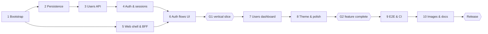

# User Management — Detailed Implementation Plan

Oct 20, 2026 · @Dmytro

## Overview

Build a pnpm monorepo with a Next.js 15 web app, a NestJS API and PostgreSQL, delivered in 10 phases and about 60 tasks, each ending in a verified commit. The plan below breaks the source plan into tasks with acceptance criteria so every phase can be picked up and closed independently.

**Locked decisions** (change here first, everything downstream follows):

| Area | Choice | Why |
| --- | --- | --- |
| Workspace | pnpm workspaces: `apps/web`, `apps/api`, `packages/shared` | Shared Zod contracts and types between web and API |
| Runtime | Node 22 LTS, TypeScript 5.x strict | Meets the >=22 / >=5 requirement |
| Web | Next.js 15 App Router, MUI 6, React Hook Form + Zod, TanStack Query | Required framework; mature form and cache tooling |
| API | NestJS 11 (Express), class-validator or Zod pipes | Explicit REST layer, guards, filters |
| Data | PostgreSQL 16, Prisma ORM + migrations | Typed client, migration history |
| Auth transport | Next.js BFF sets HttpOnly cookie; forwards `X-Session-Id` to API | Keeps the session ID out of JS while meeting the per-request header requirement |
| Passwords | Argon2id | Current OWASP recommendation |
| Tests | Vitest + Supertest (API), Vitest + RTL (web), Playwright 1.50+ (E2E) | One runner for unit and component tests |
| Runtime | Docker Compose: `db`, `migrate` (one-shot), `api`, `web`, `e2e` profile | Avoids migration races; one-command start |

**Conventions**

- Conventional Commits; one commit per verified task group, never a broken build on `main`.
- No hiring-company name anywhere: repo, README, UI, package names, commit messages.
- Shared error shape `{ code, message, details? }`; dates as ISO 8601 UTC strings.
- Every task below is done only when its acceptance criteria pass locally and in CI.

## Milestones and sequencing

Ship the vertical slice (sign-up → dashboard → logout → sign-in) at gate G1 before any CRUD polish; API and web shell work can overlap until then.

Gate criteria:

- **G1 vertical slice** — E2 passes against the Compose stack; API integration suite green.
- **G2 feature complete** — all CRUD, pagination and theme tasks closed; component tests green.
- **Release** — T10.7 cold start from a clean clone passes the full E2E suite; branding sweep clean.

## Phase tasks

Each task lists what to build and the check that closes it. IDs (T1.1…) are referenced by the test matrix and traceability table.

### Phase 1 — Bootstrap monorepo

Commit: `chore: bootstrap TypeScript monorepo`

- [x] **T1.1** Init repo, `.gitignore`, `.nvmrc` (22), `packageManager` pin, `pnpm-workspace.yaml` with `apps/*`, `packages/*`. *Done when:* `pnpm install` succeeds from clean clone.
- [x] **T1.2** Root `tsconfig.base.json` (strict, `noUncheckedIndexedAccess`, ES2022), per-package `tsconfig` extending it. *Done when:* `pnpm -r typecheck` passes on empty packages.
  - *Note:* TypeScript pinned to `~5.9` (typescript-eslint does not support TS 7 yet; meets >=5).
- [x] **T1.3** ESLint (flat config, typescript-eslint) + Prettier; root scripts `lint`, `format`, `typecheck`, `test`. *Done when:* `pnpm lint` passes.
- [x] **T1.4** `packages/shared`: Zod schemas + inferred types for `User`, `UserStatus`, `Session`, `SignUpInput`, `SignInInput`, `CreateUserInput`, `UpdateUserInput`, `PaginatedResponse<T>`, `ApiError`. *Done when:* both apps import it via `workspace:*`.
- [x] **T1.5** `.env.example` with `POSTGRES_PASSWORD`, `DATABASE_URL`, `API_INTERNAL_URL`, `SESSION_TTL_HOURS`, `COOKIE_SECURE`. *Done when:* every variable read in code is listed.
- [x] **T1.6** Husky + lint-staged pre-commit (lint, format). *Done when:* a bad commit is blocked.

### Phase 2 — Persistence

Commit: `feat(api): add user and session persistence`

- [x] **T2.1** Scaffold NestJS app in `apps/api`; `ConfigModule` with Zod-validated env; `GET /health` (DB ping). *Done when:* app boots and `/health` returns 200.
  - *Note:* NestJS pinned to `^11` (v12 is ESM-only). `/health` returns 503 `SERVICE_UNAVAILABLE` when the DB is down. Tests via Vitest + `unplugin-swc` (decorator metadata); `test` = unit, `test:int` = real Postgres.
- [x] **T2.2** Prisma schema: `User` (uuid id, firstName/lastName varchar(100), email unique varchar(255), passwordHash, status enum ACTIVE/INACTIVE default ACTIVE, loginsCount int default 0, createdAt default now, updatedAt `@updatedAt`), `Session` (uuid id, userId FK, createdAt, terminatedAt nullable, expiresAt). *Done when:* `prisma validate` passes.
- [x] **T2.3** Indexes: `users(email)` unique, `users(created_at, id)`, `sessions(user_id, terminated_at)`; FK `onDelete: Cascade` for sessions. *Done when:* migration SQL shows all three.
- [x] **T2.4** Initial migration + `PrismaService` with graceful shutdown. *Done when:* `prisma migrate deploy` applies on an empty DB.
  - *Note:* Prisma pinned to `7.10.1` (v8 is RC): `prisma-client` generator (CJS) to gitignored `src/generated/prisma`, `prisma.config.ts`, `@prisma/adapter-pg`. Migration SQL verified on Postgres 16; confirm with `pnpm --filter api exec prisma migrate dev` locally (should report no drift).
- [x] **T2.5** Seed script: 1 known admin (dev only) + 13 random users (exercises 3 pages). *Done when:* `pnpm --filter api db:seed` is idempotent.
  - *Note:* admin credentials from `SEED_ADMIN_EMAIL` / `SEED_ADMIN_PASSWORD`; refuses `NODE_ENV=production`; matches by email, never overwrites.
- [ ] **T2.6** `compose.yaml` with `db` only (healthcheck, named volume) for local dev. *Done when:* `docker compose up db` is healthy.
  - *Note:* file written and `docker compose config` validated; port bound to `127.0.0.1:5433` (avoids a host Postgres on 5432) for host-side dev. Pending: run `docker compose up -d db` locally and confirm healthy.

### Phase 3 — Users API

Commit: `feat(api): implement user management`

- [ ] **T3.1** Global `ValidationPipe`/Zod pipe (whitelist, forbid unknown), global exception filter mapping to `{ code, message, details? }`; Prisma P2002 → 409, P2025 → 404, connection errors → 503. *Done when:* unit tests cover each mapping.
- [ ] **T3.2** `UsersService.list(page, limit)`: order `createdAt DESC, id DESC`, `limit` fixed max 6, `page >= 1`, returns `{ data, pagination: { page, limit, total, totalPages } }`. *Done when:* page beyond last returns empty `data` with correct totals.
- [ ] **T3.3** `UsersService.create`: trim names, reject empty, hash password, default ACTIVE. *Done when:* response never contains `passwordHash`.
- [ ] **T3.4** `UsersService.update`: DTO allows only `firstName`, `lastName`, `status`; name change uses conditional update `WHERE id = ? AND status = 'ACTIVE'` in the same transaction as any status change; inactive + name change → 403 `USER_INACTIVE`. *Done when:* reactivating and renaming in one request is ordered status-first (documented).
- [ ] **T3.5** `UsersService.delete`: transaction deletes sessions then user (or cascade). *Done when:* deleted user's session gets 401.
- [ ] **T3.6** `UsersController`: `GET /users`, `POST /users`, `PATCH /users/:id` (ParseUUIDPipe), `DELETE /users/:id` (204). *Done when:* Supertest suite green.
- [ ] **T3.7** User serializer/mapper used by every response path. *Done when:* a test asserts no response body includes `password`.

### Phase 4 — Authentication & sessions

Commit: `feat(auth): implement session authentication`

- [ ] **T4.1** `PasswordService` (argon2id hash/verify), min length 8. *Done when:* unit tests for hash/verify/mismatch.
- [ ] **T4.2** `SessionsService.createForUser(userId)`: one transaction — lock user row (`SELECT … FOR UPDATE`), reject INACTIVE (403), insert session with `expiresAt`, increment `loginsCount`. *Done when:* concurrent-signin test shows count == sessions created.
- [ ] **T4.3** `POST /auth/sign-up`: create user + session in one transaction; 409 on duplicate email; returns `{ id: sessionId, user }`. Signup counts as first login (`loginsCount = 1`). *Done when:* integration test passes.
- [ ] **T4.4** `POST /auth/sign-in`: verify credentials (constant-time path for unknown email), call `createForUser`; 401 on bad credentials, 403 on inactive. *Done when:* inactive sign-in test passes.
- [ ] **T4.5** `SessionGuard` (global, `@Public()` opt-out): reads `X-Session-Id`, validates UUID, session exists, not terminated, not expired, user exists; attaches `req.auth`. *Done when:* every non-public route rejects missing/terminated/expired session with 401.
- [ ] **T4.6** `GET /auth/me` returns session + safe user. *Done when:* integration test passes.
- [ ] **T4.7** `DELETE /sessions/:id`: only the caller's own session; sets `terminatedAt` once; repeat returns 204. *Done when:* another user's session ID returns 404.
- [ ] **T4.8** `POST /sessions`: requires email + password body (credential-verified), never a bare `userId`. *Done when:* request with only `userId` returns 400.
- [ ] **T4.9** OpenAPI via `@nestjs/swagger` at `/docs` (dev only). *Done when:* all 9 endpoints documented with examples.

### Phase 5 — Web shell & BFF

Commit: `feat(web): add app shell and session integration`

- [ ] **T5.1** Scaffold Next.js 15 in `apps/web` (App Router, `output: 'standalone'`). *Done when:* `pnpm --filter web build` succeeds.
- [ ] **T5.2** BFF route handlers under `app/api/[...path]/route.ts`: forward to `API_INTERNAL_URL`, inject `X-Session-Id` from HttpOnly cookie `sid`, pass status + body through. *Done when:* browser never sees the API host or the session ID.
- [ ] **T5.3** BFF auth handlers: `sign-up`/`sign-in` set cookie `sid` (HttpOnly, SameSite=Lax, Secure via env, Max-Age = TTL) and return user only; `sign-out` calls `DELETE /sessions/:id` and clears cookie. *Done when:* cookie flags verified in a test.
- [ ] **T5.4** `middleware.ts`: no `sid` on `/dashboard` → redirect `/sign-in`; `sid` on auth pages → `/dashboard`. Server components confirm via `/auth/me` (cookie presence alone is not trusted). *Done when:* E2E route-protection test passes.
- [ ] **T5.5** MUI setup with `AppRouterCacheProvider`, light/dark themes, TanStack Query provider, typed `apiClient` with central 401 → redirect. *Done when:* a 401 from any query lands on `/sign-in`.
- [ ] **T5.6** Root `/` page: `/auth/me` → `/dashboard` if authenticated, else `/sign-up`. *Done when:* both branches covered by E2E.

### Phase 6 — Auth flows (UI)

Commit: `feat(web): add authentication flows`

- [ ] **T6.1** `/sign-up` form: first name, last name, email, password, confirm password; Zod `refine` on password match; submit disabled while pending. *Done when:* RTL test proves mismatch makes no network call.
- [ ] **T6.2** `/sign-in` form: email, password; server errors mapped to field/form messages (401 generic "invalid credentials", 403 "account inactive"). *Done when:* both error states render.
- [ ] **T6.3** On success: invalidate `['me']` query, `router.replace('/dashboard')`. *Done when:* back button does not return to the form.
- [ ] **T6.4** Cross-links sign-up ⇄ sign-in; accessible labels, autocomplete attributes, keyboard submit. *Done when:* axe check shows no violations.

### Phase 7 — Users dashboard

Commit: `feat(web): implement user dashboard`

- [ ] **T7.1** Layout: app bar with current user name, theme toggle, logout. *Done when:* logout ends on `/sign-in` and the old cookie is rejected.
- [ ] **T7.2** Users table: name, email, status chip, logins, created, updated; page from `?page=` search param; MUI `Pagination` with `totalPages`. *Done when:* 13 users → 3 pages of 6/6/1.
- [ ] **T7.3** Loading skeleton, empty state, error state with retry. *Done when:* each state has a component test.
- [ ] **T7.4** Create dialog (names, email, password, status). *Done when:* new user appears on page 1 after success.
- [ ] **T7.5** Edit dialog: names disabled when status is INACTIVE (re-enabled live when switched to ACTIVE); `createdAt` read-only. *Done when:* RTL test for disabled inputs.
- [ ] **T7.6** Delete confirmation dialog; deleting last row on a page moves to previous page. *Done when:* E2E covers the edge.
- [ ] **T7.7** Mutations invalidate `['users']`; snackbar success/error feedback; non-optimistic by default. *Done when:* failed mutation leaves table unchanged.
- [ ] **T7.8** Deleting or deactivating your own account: confirm, then sign out (deleted) or keep session (deactivated, documented). *Done when:* behavior documented in README.

### Phase 8 — Theme persistence & polish

Commit: `feat(web): persist theme preference`

- [ ] **T8.1** Theme stored in `localStorage` key `theme` **and** mirrored to a `theme` cookie so the server renders the right mode (no flash). *Done when:* reload in dark mode shows no light flash.
- [ ] **T8.2** Default from `prefers-color-scheme` when nothing stored. *Done when:* unit test of resolver.
- [ ] **T8.3** Responsive pass: table collapses to cards under 600 px. *Done when:* mobile Playwright smoke passes.
- [ ] **T8.4** Copy, focus management in dialogs, `<title>` per page. *Done when:* manual review checklist ticked.

### Phase 9 — E2E & CI

Commit: `test: cover core user journeys with Playwright`

- [ ] **T9.1** `playwright.config.ts`: `baseURL` from env, Chromium + mobile project, traces on failure. *Done when:* `pnpm e2e` runs against local stack.
- [ ] **T9.2** Test isolation: per-run unique emails, API reset endpoint **only** in `NODE_ENV=test` or a fresh DB per run via Compose `e2e` profile. *Done when:* suite passes twice in a row.
- [ ] **T9.3** Specs: `auth.spec.ts`, `users.spec.ts`, `theme.spec.ts`, `sessions.spec.ts` (cases in the test matrix). *Done when:* all green.
- [ ] **T9.4** Compose `e2e` service using `mcr.microsoft.com/playwright` image, depends on healthy `web`. *Done when:* `docker compose --profile e2e up --exit-code-from e2e` returns 0.
- [ ] **T9.5** GitHub Actions: install → lint → typecheck → unit/integration (Postgres service) → Docker build → E2E via Compose; upload Playwright report. *Done when:* pipeline green on `main`.

### Phase 10 — Production images & docs

Commit: `docs: document Docker Compose setup and tradeoffs`

- [ ] **T10.1** `apps/api/Dockerfile`: multi-stage (deps → build with `pnpm deploy --prod` → runtime `node:22-alpine`), non-root user, Prisma engines included. *Done when:* image < 300 MB and runs.
- [ ] **T10.2** `apps/web/Dockerfile`: multi-stage, Next standalone output + static assets, non-root. *Done when:* container serves `/`.
- [ ] **T10.3** `migrate` one-shot service runs `prisma migrate deploy`; `api` depends on it with `service_completed_successfully`. *Done when:* cold start applies migrations exactly once.
- [ ] **T10.4** `.dockerignore` files; only `web:3000` published; healthchecks on all services. *Done when:* `docker compose ps` all healthy.
- [ ] **T10.5** Optional `seed` service behind a `seed` profile. *Done when:* documented command works.
- [ ] **T10.6** README: architecture diagram, prerequisites, env vars, setup, commands, tests, API summary, design decisions, tradeoffs, known limitations, future work. *Done when:* a fresh reader starts the stack from it alone.
  - *Note:* initial README added (overview, architecture, layout, API summary, dev setup); Compose, tests, tradeoffs and limitations still to document.
- [ ] **T10.7** Cold-start verification on a clean machine/clone: `cp .env.example .env && docker compose up --build`. *Done when:* full E2E passes against it.
- [ ] **T10.8** Final branding sweep: `git grep -i` for the company name across tree and history. *Done when:* zero hits.

## Test matrix

Thirty-two cases cover every business rule at the cheapest layer that proves it; E2E only checks journeys end to end.

| ID | Layer | Case | Covers |
| --- | --- | --- | --- |
| U1 | API unit | Name trim/empty rejection | T3.3 |
| U2 | API unit | Update DTO strips createdAt, updatedAt, loginsCount, passwordHash | T3.4 |
| U3 | API unit | Password hash/verify/mismatch | T4.1 |
| U4 | API unit | Guard rejects missing, malformed, terminated, expired session | T4.5 |
| U5 | API unit | Exception filter maps Prisma/validation errors to 400/404/409/503 | T3.1 |
| I1 | API integration | Sign-up creates user + session, loginsCount = 1 | T4.3 |
| I2 | API integration | Sign-in increments loginsCount exactly once | T4.4 |
| I3 | API integration | Inactive user sign-in → 403, no session row | T4.2 |
| I4 | API integration | Duplicate email → 409 | T4.3 |
| I5 | API integration | Pagination with 0 / 6 / 7 / 13 users: counts, totalPages, stable order | T3.2 |
| I6 | API integration | Update bumps updatedAt, never createdAt | T3.4 |
| I7 | API integration | Inactive user name change → 403; status change allowed | T3.4 |
| I8 | API integration | Delete user revokes sessions (subsequent 401) | T3.5 |
| I9 | API integration | 10 concurrent sign-ins → loginsCount += 10 | T4.2 |
| I10 | API integration | Deactivate racing sign-in → no session for inactive user | T4.2 |
| I11 | API integration | Terminate session twice → 204, 204; then 401 on use | T4.7 |
| I12 | API integration | `POST /sessions` with only userId → 400 | T4.8 |
| I13 | API integration | All protected routes → 401 without header | T4.5 |
| I14 | API integration | No response contains passwordHash | T3.7 |
| C1 | Web component | Password mismatch blocks submit, no fetch | T6.1 |
| C2 | Web component | Field validation messages | T6.1, T6.2 |
| C3 | Web component | Table renders 6 rows + pagination | T7.2 |
| C4 | Web component | Loading / empty / error states | T7.3 |
| C5 | Web component | Name inputs disabled for INACTIVE | T7.5 |
| C6 | Web component | Delete requires confirmation | T7.6 |
| C7 | Web unit | Theme resolver + persistence | T8.1, T8.2 |
| E1 | E2E | Unauthenticated `/dashboard` → `/sign-in`; `/` → `/sign-up` | T5.4, T5.6 |
| E2 | E2E | Sign up → dashboard → logout → sign in | Phases 5–7 |
| E3 | E2E | Create, edit, delete user | T7.4–T7.6 |
| E4 | E2E | 7+ users → page 2 exists with remaining rows | T7.2 |
| E5 | E2E | Dark theme persists after new browser context with stored state | T8.1 |
| E6 | E2E | Terminated session cookie no longer works; inactive user cannot sign in; mobile viewport smoke | T4.5, T4.4, T8.3 |

Integration tests run against a real Postgres (Compose service in CI, `testcontainers` locally), truncating tables between tests.

## Requirements traceability

Every challenge requirement maps to at least one task and one test.

| Requirement | Tasks | Tests |
| --- | --- | --- |
| Node >=22, TS >=5, Next >=15, Playwright >=1.50 | T1.1, T1.2, T5.1, T9.1 | CI |
| User CRUD REST | T3.2–T3.6 | I5–I8, E3 |
| Create / terminate sessions | T4.2, T4.7, T4.8 | I9–I12, E6 |
| User and session fields | T2.2 | I1, I6 |
| createdAt immutable, updatedAt on change | T2.2, T3.4 | U2, I6 |
| Inactive: no name change, no session | T3.4, T4.2 | I3, I7, I10, C5 |
| Sign-up/sign-in with password confirm on client | T4.3, T4.4, T6.1 | C1, E2 |
| Session ID sent on every authenticated request | T4.5, T5.2 | U4, I13 |
| Dashboard only for authenticated users | T5.4 | E1 |
| Six users per page | T3.2, T7.2 | I5, C3, E4 |
| Theme persists across browser restarts | T8.1 | C7, E5 |
| Tests, README, Compose, Git history | Phases 9–10 | CI, T10.7 |

### Definition of done

- [ ] `docker compose up --build` from a clean clone with `.env` brings up a healthy stack at `http://localhost:3000`.
- [ ] All 9 endpoints implemented and documented (OpenAPI + README examples).
- [ ] Argon2id hashes only; session checked on every protected request; logout invalidates the session.
- [ ] Inactive users cannot sign in or rename; createdAt immutable; updatedAt maintained.
- [ ] Exactly six users per page with correct navigation.
- [ ] Theme survives browser restart without a flash.
- [ ] Unit, integration and Playwright suites pass locally and in CI.
- [ ] README complete, including tradeoffs and limitations.
- [ ] Granular Conventional Commits; zero hiring-company references.

## Risks and open decisions

The biggest risk is late Docker/E2E integration; containerize by Phase 5 and run the stack daily, not only in Phase 10.

| Risk | Impact | Mitigation |
| --- | --- | --- |
| Prisma engines or argon2 native build fail on Alpine | Broken images late | Build images in Phase 2/5 spikes; fall back to `node:22-slim` |
| MUI + App Router SSR styling/hydration issues | Theme flash, warnings | Use `@mui/material-nextjs` cache provider; cookie-driven initial theme (T8.1) |
| Flaky E2E from shared DB state | CI noise | Unique data per test, fresh DB per CI run (T9.2) |
| Race between status change and session creation | Rule violation | Row lock in one transaction (T4.2), tested by I10 |
| Scope creep in polish | Missed core items | Vertical slice (Phases 1–6) before CRUD polish |

**Open decisions** (defaults chosen; record final answers in README):

- [ ] Sign-up increments loginsCount — default **yes** (it creates a session).
- [ ] User deletion — default **hard delete** with session cascade.
- [ ] Admins may reactivate inactive users — default **yes**.
- [ ] Session TTL — default **24 h**, no sliding renewal.
- [ ] Deactivating yourself — default allowed, current session stays valid until logout (alternatively revoke immediately).

**README tradeoffs to state:** all users are admins by challenge design (production needs RBAC and audit); session ID via BFF cookie + header (production adds CSRF tokens, rotation, rate limiting, lockout, email verification); offset pagination is fine at this scale (cursor pagination for large sets); add structured logs, request IDs, metrics and backups for production.
